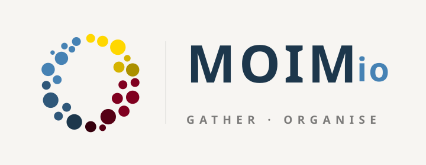
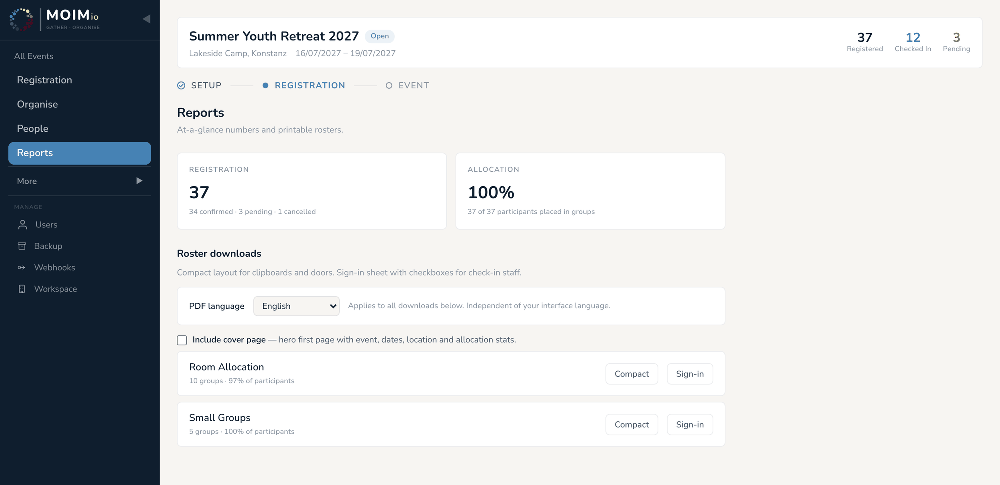
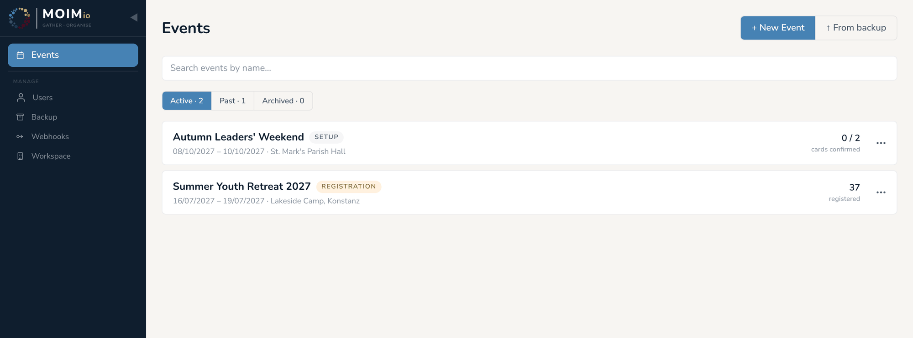
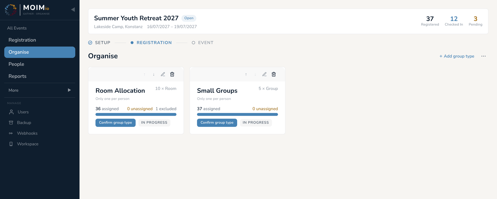
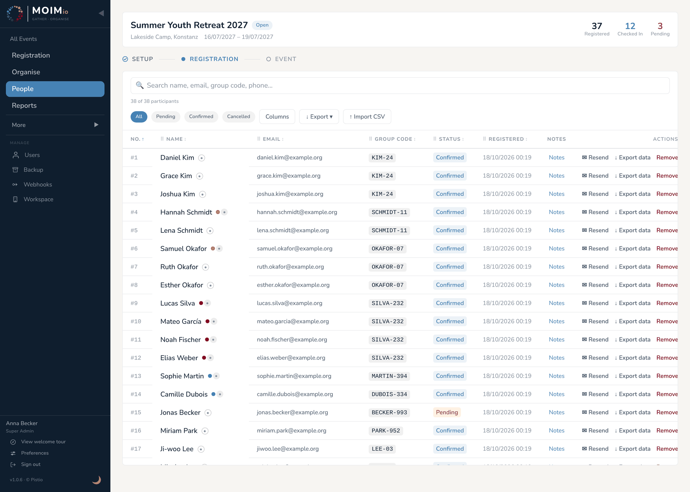
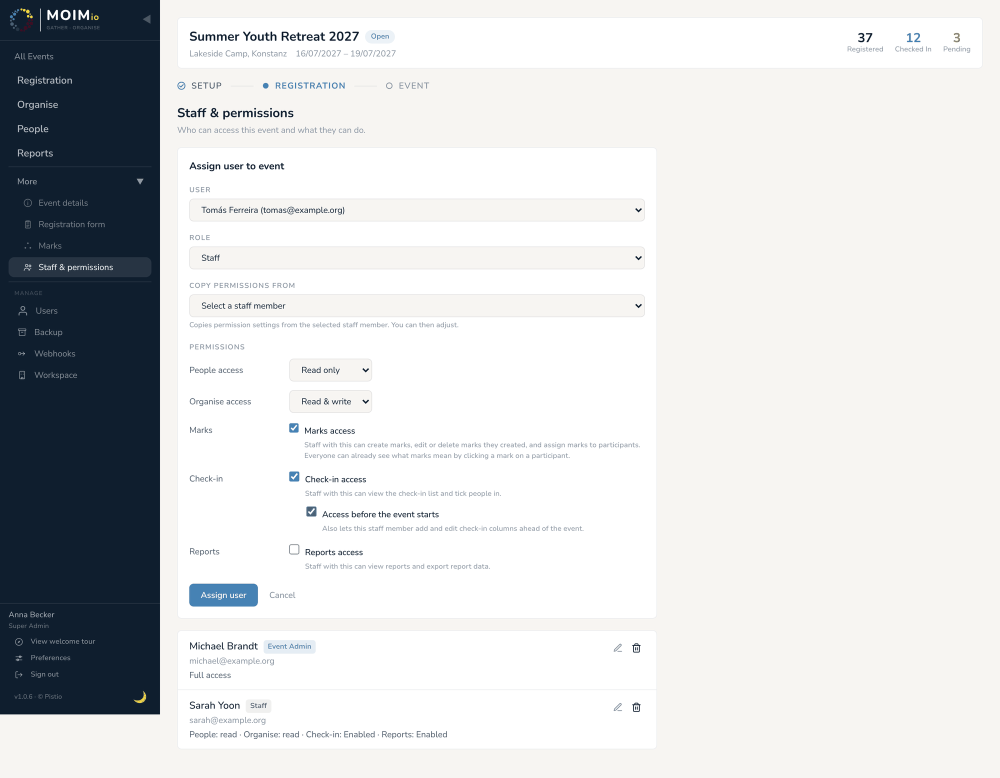

<p align="center">🌐 <a href="README.md">English</a> · <a href="README.de.md">Deutsch</a> · <a href="README.ko.md">한국어</a> · <a href="README.es.md">Español</a> · <a href="README.pt-BR.md">Português (Brasil)</a> · <b>Français</b></p>

<div align="center">



### Gather · Organise

**Inscriptions, chambres, petits groupes et check-in pour votre retraite, votre camp ou votre conférence : tout au même endroit, sur votre propre serveur.**

[](LICENSE)
[](docs/installation/README.fr.md)
[](#-moimio-parle-votre-langue)
[](CHANGELOG.md)

[**Ce que fait Moimio**](#-moimio-en-bref) · [**Comment ça marche**](#-comment-ça-marche) · [**Bien démarrer**](#-bien-démarrer) · [**Manuel**](docs/manual/README.fr.md) · [**FAQ**](docs/faq.md)

<br>

<picture>
  <source media="(prefers-color-scheme: dark)" srcset="docs/assets/allocation-board-dark.png">
  
</picture>

<sub><i>« Mais que tout se fasse avec bienséance et avec ordre. » (1 Corinthiens 14:40)</i></sub>

</div>

---

## 👋 Moimio en bref

Si vous avez déjà organisé une retraite d’église, un camp de jeunes, une conférence missionnaire ou un week-end en famille, vous connaissez la chanson. Les inscriptions arrivent par e-mail, la liste des chambres vit dans un tableur, les petits groupes dans un autre, et le week-end qui précède l’événement passe à recopier des noms d’un onglet à l’autre en espérant n’oublier personne.

**Moimio remplace ce jonglage entre tableurs.** C’est une application web gratuite qui :

1. **Recueille les inscriptions** grâce à un formulaire simple que vous partagez sous forme de lien ou de QR code.
2. **Répartit les participants dans les chambres, petits groupes, équipes ou ateliers** en un clic, en gardant ensemble familles et amis, en respectant les chambres réservées aux hommes ou aux femmes, et en suivant les règles que vous fixez.
3. **Vous accompagne pendant l’événement lui-même** : listes et feuilles de présence à imprimer, et un écran de check-in pour l’accueil.

Nul besoin d’être technicien pour *utiliser* Moimio. Si vous savez remplir un formulaire web et faire glisser un nom d’une case à une autre, vous pouvez organiser un événement avec.

> **Le nom.** *Moimio* vient du coréen **모임이오**, « C’est un rassemblement ! »

---

## 🙋 Pour qui ?

Moimio est conçu pour les **petits et moyens événements organisés par des bénévoles**, en général entre 20 et quelques centaines de personnes :

| ⛪ Églises | 🏕️ Camps et retraites | 🌍 Conférences missionnaires | 👨‍👩‍👧 Week-ends familles et jeunes |
|:---:|:---:|:---:|:---:|
| Week-ends d’église, rotations de petits groupes | Chalets, dortoirs, groupes d’activités | Délégués, ateliers, tables de langue | Garder les familles ensemble, mélanger les ados |

Ce n’est pas un logiciel de billetterie pour entreprises. Pas de paiement en ligne, pas d’outils marketing. Il fait une seule chose, **mettre les bonnes personnes aux bons endroits**, et il la fait bien.

---

## ✨ Ce que vous pouvez faire

| | |
|---|---|
| 📝 **Votre propre formulaire d’inscription** | Choisissez les questions à poser (téléphone, date de naissance, église, régime alimentaire, tout ce que vous voulez). Partagez-le par lien ou QR code. On peut inscrire toute une famille en une seule fois. |
| 👨‍👩‍👧 **Familles et amis restent ensemble** | Chaque inscription reçoit un court **code de groupe**. Les personnes qui veulent être ensemble partagent le même code, et Moimio les place dans la même chambre ou le même groupe. |
| ✦ **Répartition en un clic** | Appuyez sur **Attribution automatique** et Moimio propose qui va où. Vous voyez d’abord toute la proposition, puis vous l’acceptez ou l’abandonnez. Rien ne change sans votre accord. |
| 🏷️ **Les marques : vos propres étiquettes de couleur** | Identifiez des personnes comme *Responsable*, *Nouveau venu*, *Équipe de louange* ou autre. Demandez à Moimio de répartir les responsables uniformément entre les groupes, ou de garder l’équipe de louange ensemble. |
| 🚻 **Chambres hommes et chambres femmes** | Définissez chaque chambre comme mixte, réservée aux hommes ou réservée aux femmes. Moimio ne contourne jamais la règle, et un glisser-déposer malencontreux non plus. |
| ✋ **Vous gardez la main** | Faites glisser n’importe qui n’importe où. Verrouillez une chambre terminée pour que le moteur n’y touche plus. Excluez quelqu’un de la répartition des chambres tout en le gardant dans son petit groupe. |
| 🖨️ **Listes à imprimer** | Listes compactes pour la porte, feuilles de présence avec cases à cocher pour l’accueil, listes détaillées pour l’équipe. Imprimez-les dans l’une des six langues. |
| ✅ **Check-in sur tablette ou téléphone** | Une liste plein écran pour l’accueil. Ajoutez vos propres colonnes à cocher, comme *Payé*, *Bracelet* ou *Autorisation parentale*. |
| 👥 **Embarquez votre équipe** | Donnez à chaque bénévole exactement l’accès dont il a besoin : lecture seule, check-in uniquement ou accès complet, événement par événement. |
| 🔒 **Confidentialité intégrée** | Remettez à chacun ses propres données en un clic, supprimez proprement les personnes et liez votre propre politique de confidentialité depuis le formulaire d’inscription. |

---

## 🧭 Comment ça marche

Chaque événement passe par trois phases simples. Moimio vous indique où vous en êtes et ce qu’il reste à faire.

### 1 · Configuration : *définissez votre événement*

Donnez à votre événement un nom, des dates et un lieu. Choisissez les questions de votre formulaire d’inscription. Créez vos chambres et vos groupes. Une liste de contrôle vous indique ce qui manque encore.

<p align="center"></p>

### 2 · Inscription : *laissez les gens s’inscrire*

Ouvrez les inscriptions et partagez le formulaire. Regardez les inscriptions arriver en direct. En attendant, vous pouvez déjà commencer à placer les personnes dans les chambres et les groupes.

<table>
<tr>
<td width="32%" valign="top"></td>
<td valign="top"><br><sub>Appuyez sur <b>Attribution automatique</b> et Moimio vous montre une proposition. Acceptez-la avec <b>Valider la répartition</b>, ou cliquez sur <b>Abandonner</b>. Rien n’est enregistré tant que vous n’avez pas décidé.</sub></td>
</tr>
</table>

### 3 · Événement : *accueillez tout le monde*

Fermez les inscriptions, imprimez vos listes et ouvrez l’écran de check-in sur une tablette à l’entrée.

<table>
<tr>
<td width="50%"></td>
<td width="50%"></td>
</tr>
</table>

<details>
<summary><b>📸 Plus de captures d’écran</b></summary>
<br>

| | |
|:---:|:---:|
| <br><sub>Tous vos événements dans une seule liste</sub> | <br><sub>Répartition : vos types de groupe en un coup d’œil</sub> |
| <br><sub>Toutes les personnes inscrites, avec recherche et tri</sub> | <br><sub>Choisissez ce que chaque bénévole peut voir et faire</sub> |
| <br><sub>Dites au moteur ce qui compte pour vous</sub> | <br><sub>La configuration initiale prend une minute</sub> |

</details>

---

## 🚀 Bien démarrer

Il y a deux façons d’utiliser Moimio. **Les deux font tourner la même application, avec les mêmes fonctionnalités.**

<table>
<tr>
<th width="50%">☁️ Utiliser la version hébergée</th>
<th width="50%">🏠 L’héberger vous-même (gratuit)</th>
</tr>
<tr>
<td valign="top">

**Idéal si vous voulez simplement organiser un événement.**

Inscrivez-vous sur **[moimio.app](https://moimio.app)** et commencez tout de suite. Pas de serveur, pas d’installation, et les mises à jour sont gérées pour vous.

</td>
<td valign="top">

**Idéal si vous voulez garder le contrôle total de vos données.**

Installez **Moimio CE** (Community Edition, ce dépôt) sur un petit serveur loué, un ordinateur inutilisé ou un mini-PC dans le bureau de l’église. C’est gratuit pour toujours, et les données ne quittent jamais votre machine.

👉 Commencez par le **[guide pas à pas pour débutants](docs/installation/beginner.fr.md)**. Il ne suppose aucune connaissance technique et prend environ deux heures la première fois.

</td>
</tr>
</table>

<details>
<summary><b>🛠️ Installation rapide pour les habitués de Docker</b></summary>
<br>

Il vous faut une machine avec [Docker](https://docs.docker.com/get-docker/) et Docker Compose.

```bash
git clone https://github.com/jc-universe87/moimio.git
cd moimio
cp .env.example .env        # puis modifiez SECRET_KEY et POSTGRES_PASSWORD
docker compose up -d --build
```

Ouvrez **http://localhost:6120** et créez le premier compte administrateur sur l’écran de configuration.

| Service | Adresse |
|---|---|
| Moimio (l’application) | http://localhost:6120 |
| API backend | http://localhost:6121 |
| Documentation de l’API | http://localhost:6121/docs |
| Vérification de l’état | http://localhost:6121/health |

Pour le HTTPS, l’e-mail, les sauvegardes et la sécurisation, suivez le **[guide d’installation rapide](docs/installation/quick-guide.fr.md)**.

**La mise à jour** se fait en une commande depuis le dossier du projet. Elle sauvegarde d’abord vos paramètres et votre base de données, et vous indique comment revenir en arrière en cas de problème :

```bash
./upgrade.sh           # mettre à jour vers la dernière version de votre branche
./upgrade.sh v1.0.6    # ou passer à une version précise (voir CHANGELOG.md)
```

**Images de conteneur.** Chaque version est publiée sous `ghcr.io/jc-universe87/moimio-backend:<version>` et `ghcr.io/jc-universe87/moimio-frontend:<version>`, par exemple `v1.0.6`. Fixez toujours une version. Le tag `:latest` est figé sur v1.0.6, n’évolue plus et n’est pas pris en charge.

</details>

---

## 📚 Documentation

| Je veux… | À lire |
|---|---|
| **Organiser rapidement mon premier événement** | [Guide rapide](docs/manual/quick-guide.fr.md) : un événement du début à la fin, en une dizaine de minutes de lecture |
| **Découvrir toutes les fonctionnalités** | [Manuel d’utilisation](docs/manual/README.fr.md) : onze courts chapitres, de la configuration au check-in |
| **Installer Moimio moi-même** | [Guide d’installation](docs/installation/README.fr.md) : un parcours débutant et un parcours administrateur système |
| **Trouver une réponse rapide** | [FAQ](docs/faq.md) (en anglais) |
| **Chercher un terme** (code de groupe, marque, type de groupe…) | [Glossaire](docs/glossary.md) (en anglais) |
| **Comprendre la confidentialité et le RGPD** | [Conformité RGPD](docs/gdpr-compliance.md) (en anglais) |
| **Passer à un nouveau serveur** | [Déplacer un espace de travail](docs/moving-a-workspace.md) (en anglais) |
| **Connecter Slack, Zapier ou n8n** | [Webhooks](docs/webhooks.md) (en anglais) |
| **Lire le contexte technique** | [Architecture](ARCHITECTURE.md) · [Modèle de données](docs/data-model.md) · [Règle de traduction](TRANSLATION_RULE.md) (en anglais) |

---

## 🌍 Moimio parle votre langue

Toute l’application, ainsi que chaque liste imprimée, est disponible en six langues :

**English · Deutsch · 한국어 · Español · Português (Brasil) · Français**

Chaque membre de l’équipe choisit sa propre langue, et la langue des PDF se choisit séparément. Un organisateur francophone peut imprimer une liste en anglais pour une équipe internationale. Vous souhaitez ajouter une langue ? Consultez [TRANSLATION_RULE.md](TRANSLATION_RULE.md).

---

## 🔒 Vos données restent les vôtres

- **Auto-hébergé, c’est auto-possédé.** Avec Moimio CE, les données des participants sont stockées dans une base de données sur votre serveur. Aucun tiers ne les traite.
- **Rien ne sort sans votre choix.** Les e-mails ne partent que si vous configurez un compte de messagerie, et les webhooks ne se déclenchent que si vous en ajoutez un.
- **Les outils RGPD sont intégrés** : export des données personnelles en un clic, modification, suppression en bonne et due forme, sauvegardes, et un lien vers votre propre politique de confidentialité sur le formulaire d’inscription.

Pour en savoir plus : [Conformité RGPD](docs/gdpr-compliance.md) (en anglais).

---

## 🤝 Contribuer

Tickets, idées et pull requests sont les bienvenus, de la part de tout le monde.

- **Vous avez trouvé un bug ou vous avez une idée ?** [Ouvrez un ticket](https://github.com/jc-universe87/moimio/issues/new/choose). Les modèles vous guideront.
- **« Le manuel n’explique pas X »** est aussi un très bon ticket.
- **Vous voulez proposer du code ?** Lisez d’abord [CONTRIBUTING.md](CONTRIBUTING.md).
- **Vous savez traduire ?** Consultez [TRANSLATION_RULE.md](TRANSLATION_RULE.md).

Ce projet suit un [code de conduite](CODE_OF_CONDUCT.md). Pour tout problème de conduite : `contact@moimio.app`.
Problèmes de sécurité : merci d’utiliser le [signalement privé de vulnérabilités](https://github.com/jc-universe87/moimio/security/advisories/new) (voir [SECURITY.md](SECURITY.md)), et non un ticket public.

<details>
<summary><b>Pile technique</b></summary>
<br>

| Couche | Technologie |
|---|---|
| Backend | Python 3.12 · FastAPI · SQLAlchemy (async) · Alembic |
| Base de données | PostgreSQL 16 |
| Frontend | React · Vite · Tailwind CSS (installable comme application) |
| Serveur web | Caddy (frontend), uvicorn (backend) |
| Déploiement | Docker Compose |
| Authentification | JWT avec permissions par rôle et par événement |

</details>

---

## 💛 Soutenir le projet

Moimio CE est développé et maintenu par une seule personne sur son temps libre, et il est gratuit pour toujours. S’il épargne à votre équipe un week-end de tableurs, pensez à dire merci :

<p>
  <a href="https://github.com/sponsors/jc-universe87"></a>
  <a href="https://ko-fi.com/pistio"></a>
</p>

---

## 🔗 Liens

[Produit hébergé](https://moimio.app) · [Code source](https://github.com/jc-universe87/moimio) · [Tickets](https://github.com/jc-universe87/moimio/issues) · [Journal des modifications](CHANGELOG.md)

## 📄 Licence

[MIT](LICENSE) : libre d’utiliser, de modifier et d’auto-héberger, pour toujours.

---

<sub>*Le code et la documentation de Moimio CE ont été en grande partie développés avec [Claude Opus 4.7 Adaptive](https://www.anthropic.com/claude).*</sub>
