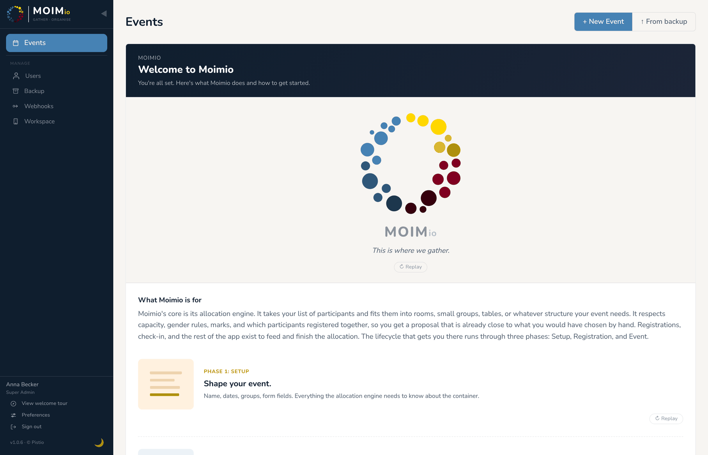

🌐 [English](beginner.md) · [Deutsch](beginner.de.md) · [한국어](beginner.ko.md) · [Español](beginner.es.md) · [Português (Brasil)](beginner.pt-BR.md) · **Français**

# Guide d’installation pour débutants

Ce guide s’adresse à quelqu’un qui n’a jamais ouvert de terminal, mais qui a besoin de faire tourner Moimio pour un vrai événement. Nous irons lentement.

Si vous êtes déjà à l’aise avec Docker et les serveurs Linux, le [guide d’installation rapide](quick-guide.fr.md) couvre le même terrain en 30 minutes.

Nul besoin d’être développeur. Il faut simplement être prêt à copier les commandes avec soin et à demander de l’aide quand quelque chose ne fonctionne pas.

---

## Un mot d’honnêteté avant de commencer

Installer Moimio demande plus d’efforts qu’installer une application de bureau. Il n’existe pas encore d’expérience « cliquez sur le bouton, patientez, c’est fini ». Si vous tombez sur un cas que le guide ne traite pas, demander à un ami plus technique ou coller le message d’erreur dans un assistant de conversation IA vous débloquera généralement en quelques minutes.

La première fois, prévoyez **environ deux heures**. L’essentiel de ce temps consiste à attendre des téléchargements. La deuxième fois, c’est beaucoup plus rapide.

---

## Faut-il vous auto-héberger ? Un regard lucide

L’installation est la partie facile. La vraie question, c’est ce que représente la gestion d’un serveur de production dans les mois qui suivent, surtout pendant un événement en cours, quand quelque chose tombe en panne et qu’il faut le remettre en route en vingt minutes.

Un Moimio auto-hébergé, c’est un petit serveur Linux dont vous êtes désormais responsable. Concrètement :

- **Le serveur doit rester allumé.** Si votre bureau subit une coupure de courant, si le Wi-Fi du lieu tombe ou si l’hébergeur du VPS a une panne, les inscriptions sont hors ligne jusqu’à ce que vous les rétablissiez.
- **Les mises à jour doivent être appliquées.** Nouvelles versions de Moimio (une commande, voir [Mettre à jour Moimio](#mettre-à-jour-moimio)), correctifs de sécurité d’Ubuntu, mises à jour occasionnelles de Docker. Pas toutes les semaines, mais pas jamais non plus.
- **Les pannes arriveront au mauvais moment.** Le renouvellement d’un certificat SSL peut échouer ; une migration de base de données peut refuser de s’exécuter après une mise à jour ; le conteneur de la base de données peut refuser de redémarrer. La solution tient généralement en une ou deux commandes, *à condition de savoir lesquelles*.
- **Les sauvegardes sont votre affaire.** Moimio a une fonction de sauvegarde, mais c’est à vous de la lancer avant un changement important et de ranger le résultat en lieu sûr.
- **DNS, certificats et tunnels sont fragiles à l’usage.** Un domaine expire, une IP change, un jeton Cloudflare est renouvelé, et le formulaire d’inscription affiche une erreur 404.

**Une auto-évaluation.** Avant de continuer, vérifiez honnêtement :

- [ ] Vous êtes à l’aise pour lancer des commandes dans un terminal et lire les messages d’erreur.
- [ ] Si un service ne démarre pas, vous savez trouver et lire ses journaux.
- [ ] Si l’adresse IP du serveur change, vous savez mettre à jour le DNS.
- [ ] Si quelque chose casse à 23 h pendant l’événement, vous avez quelqu’un (ou les compétences) pour réparer.
- [ ] Vous avez une stratégie de sauvegarde, pas seulement une bonne intention.

**Si vous avez répondu *non* à l’un de ces points, envisagez [moimio.app](https://moimio.app), la version hébergée du même produit.** Elle fait tourner le même code, le même moteur de répartition, le même parcours d’inscription. L’hébergement, les sauvegardes, les mises à jour et le SSL sont pris en charge. Les tarifs actuels sont sur le site.

Ce guide continuera de vous accompagner dans l’auto-hébergement si c’est votre choix. Le vrai coût de l’auto-hébergement, ce ne sont pas les quelques euros par mois d’un VPS : c’est la disponibilité d’astreinte pendant un événement en cours. Décidez en connaissance de cause.

---

## Choisir votre mode d’hébergement

Il existe deux façons raisonnables de faire tourner Moimio. Choisissez celle qui correspond à votre situation :

### → Voie A : louer un petit serveur (un « VPS »)

Un VPS est un petit ordinateur situé dans un centre de données, que vous louez au mois et auquel vous accédez à distance. Comptez 4 à 10 € par mois. Toujours allumé, toujours joignable, aucun matériel à entretenir de votre côté.

**Idéal si :** vous voulez peu de maintenance au quotidien, vous ouvrez les inscriptions des mois à l’avance, ou vous ne voulez pas immobiliser un ordinateur chez vous pour faire tourner Moimio.

Continuez à la section [Voie A — Louer un VPS](#voie-a--louer-un-vps) ci-dessous.

### → Voie B : héberger sur votre propre ordinateur ou mini-PC

Faites tourner Moimio sur un ordinateur que vous possédez déjà, puis rendez-le accessible sur internet grâce à un service gratuit appelé Cloudflare Tunnel. Aucun frais d’hébergement.

**Idéal si :** la souveraineté des données est une exigence ferme (vous avez précisément besoin que les données des participants restent sur du matériel vous appartenant), et vous avez quelqu’un capable de dépanner une machine Linux pendant un événement.

Une machine à la maison ou au bureau est nettement moins fiable qu’un VPS. L’alimentation, internet, le connecteur cloudflared et le système d’exploitation lui-même peuvent tomber en panne ; le formulaire d’inscription est alors hors ligne jusqu’à ce que quelqu’un aille réparer la machine. Si la souveraineté des données n’est pas une exigence ferme, la voie A (VPS) ou [moimio.app](https://moimio.app) sont des choix plus simples.

Continuez à la section [Voie B — Auto-héberger avec Cloudflare Tunnel](#voie-b--auto-héberger-avec-cloudflare-tunnel) ci-dessous.

Les deux voies se rejoignent à l’**[Étape 4 — Installer Moimio](#étape-4--installer-moimio)**, identique quel que soit l’endroit où tourne Moimio.

---

## Voie A — Louer un VPS

Un hébergeur de VPS vous fournit un petit ordinateur dans un centre de données. Il y en a beaucoup : Hetzner, OVH, Scaleway, DigitalOcean, Linode, Vultr, Contabo et de nombreux hébergeurs régionaux. La plupart facturent 4 à 10 € par mois pour ce dont Moimio a besoin.

Pour les églises et organisations missionnaires européennes, les hébergeurs disposant de centres de données en Europe sont souvent préférables pour des raisons de RGPD (les données de vos participants restent dans l’UE). Hetzner Cloud (en Allemagne / Finlande) et OVH (en France / Allemagne) sont des choix courants. Pour les organisateurs en Corée, au Japon, aux États-Unis ou ailleurs, votre hébergeur cloud local convient généralement : Moimio ne se soucie pas de celui que vous choisissez.

> **Aucune recommandation d’hébergeur.** Ce guide cite Hetzner Cloud comme *exemple*, parce qu’il est bien documenté et peu coûteux, et non comme une recommandation. Choisissez qui vous inspire confiance. La mise en place est similaire partout.

### Étape 1 — S’inscrire et créer le serveur

Chaque hébergeur de VPS a sa propre procédure d’inscription et de création de serveur. Plutôt que de redécrire pas à pas une procédure qui devient obsolète à chaque refonte de leur console, suivez la documentation de démarrage de votre hébergeur.

Pour Hetzner Cloud en particulier : <https://docs.hetzner.com/cloud/servers/getting-started/creating-a-server/>

Lors de la création du serveur, voici les choix qui comptent pour Moimio :

- **Système d’exploitation :** **Ubuntu 24.04** (ou 22.04) : ce sont les versions pour lesquelles il est le plus facile d’obtenir de l’aide en cas de problème.
- **Taille du serveur :** environ **2 vCPU + 2 Go de RAM + 40 Go de disque** suffisent largement pour un événement de 150 personnes. La plupart des hébergeurs appellent cela leur offre « small » et la facturent 4 à 5 € par mois.
- **Clé SSH :** ajoutez votre clé SSH lors de la création (pour pouvoir vous connecter sans mot de passe). Si vous n’en avez pas encore, passez à l’[Étape 2 — Générer une clé SSH](#étape-2--générer-une-clé-ssh) avant de créer le serveur, puis revenez ici.
- **Emplacement :** choisissez un centre de données proche de vos participants. Les centres de données européens sont généralement préférables pour les événements en Europe ; ailleurs, choisissez ce qui convient géographiquement et juridiquement.

Une fois le serveur créé, l’hébergeur vous donne une **adresse IP publique** (quelque chose comme `203.0.113.42`). **Notez bien cette adresse IP** : vous en aurez besoin pour vous connecter.

### Étape 2 — Générer une clé SSH

Une clé SSH, ce sont deux fichiers assortis : une **clé publique** (que vous donnez à votre hébergeur) et une **clé privée** (qui reste sur votre ordinateur portable, comme une clé de maison numérique). Ensemble, elles permettent à votre ordinateur de se connecter au serveur sans mot de passe.

Sur votre ordinateur portable, ouvrez un terminal :

- **macOS :** Spotlight → « Terminal ».
- **Linux :** n’importe quelle application de terminal.
- **Windows :** installez [Windows Terminal](https://aka.ms/terminal) depuis le Microsoft Store, ou utilisez PowerShell, fourni avec le système.

Puis saisissez :

```bash
ssh-keygen -t ed25519 -C "you@your-email.com"
```

(L’adresse e-mail n’est qu’une étiquette. Aucun e-mail n’est envoyé.) Quand on vous le demande :

- Appuyez sur Entrée pour accepter l’emplacement de fichier par défaut.
- Saisissez une phrase secrète dont vous vous souviendrez (elle protège la clé si votre ordinateur est volé). Appuyez sur Entrée.
- Saisissez de nouveau la phrase secrète. Appuyez sur Entrée.

Affichez la clé publique :

```bash
cat ~/.ssh/id_ed25519.pub
```

Cela affiche une longue ligne commençant par `ssh-ed25519 AAAA...`. Copiez la ligne entière. Ajoutez-la dans la configuration des clés SSH de votre hébergeur (chaque hébergeur a une section dédiée dans sa console). Votre serveur (au moment de sa création, ou après réinstallation) accepte désormais les connexions depuis votre ordinateur.

Si vous bloquez à cette étape, cherchez « [votre hébergeur] ajouter clé SSH » : chaque hébergeur a une documentation à ce sujet.

### Étape 3 — Se connecter au serveur

Ouvrez un terminal sur votre ordinateur portable :

```bash
ssh root@203.0.113.42
```

(Remplacez `203.0.113.42` par l’adresse IP de votre serveur.)

La première fois, un message vous demande si vous faites confiance à cet hôte. Tapez `yes` et appuyez sur Entrée. Saisissez la phrase secrète de votre clé SSH si elle vous est demandée. Vous devriez voir quelque chose comme :

```
Welcome to Ubuntu 24.04.x LTS ...
root@your-server:~#
```

C’est l’invite de commande du **serveur**. Tout ce que vous tapez maintenant s’exécute sur le serveur, pas sur votre ordinateur. **Vous y êtes.**

Si vous obtenez `Permission denied (publickey)`, votre clé SSH n’est pas associée au serveur. Vérifiez de nouveau la configuration des clés SSH chez votre hébergeur.

Passez maintenant à l’[Étape 4 — Installer Moimio](#étape-4--installer-moimio).

---

## Voie B — Auto-héberger avec Cloudflare Tunnel

Pour cette voie, il vous faut un ordinateur qui peut rester allumé en permanence : un ordinateur de bureau, un mini-PC, un vieux portable que vous n’utilisez plus, ou un Raspberry Pi 4 (4 Go ou 8 Go). Il vous faut aussi une connexion internet stable à l’endroit où se trouve cet ordinateur.

### Étape 1 — Préparer votre ordinateur

Installez **Linux** si ce n’est pas déjà fait :

- **Vieux portable ou ordinateur de bureau :** Ubuntu Desktop 24.04 LTS est le choix le plus convivial. Téléchargez-le sur <https://ubuntu.com/download/desktop> et suivez leur guide d’installation.
- **Raspberry Pi :** utilisez Raspberry Pi OS ou Ubuntu Server pour ARM. Leur documentation respective explique la mise en place.
- **Mini-PC acheté spécialement :** la plupart sont livrés avec Windows, mais Ubuntu s’installe sans difficulté. L’outil Raspberry Pi Imager et l’installateur d’Ubuntu sont tous deux bien documentés.

Vous n’êtes pas *obligé* d’utiliser Linux (Moimio fonctionne aussi sur macOS avec Docker Desktop, et sur Windows avec Docker Desktop et WSL2), mais pour un serveur qui reste allumé des mois durant, Linux est le choix le plus prévisible.

### Étape 2 — Installer Docker

Ouvrez un terminal sur l’ordinateur (pas en SSH depuis ailleurs : directement sur la machine, ou en SSH depuis un portable du même réseau si vous l’avez activé). Puis :

```bash
curl -fsSL https://get.docker.com | sudo sh
sudo usermod -aG docker $USER
```

Déconnectez-vous puis reconnectez-vous (ou redémarrez) pour que l’appartenance au nouveau groupe soit prise en compte. Vérifiez ensuite :

```bash
docker --version
docker run --rm hello-world
```

Si « Hello from Docker! » s’affiche, Docker fonctionne.

### Étape 3 — Configurer Cloudflare Tunnel

Un **Cloudflare Tunnel** est un service gratuit qui donne une adresse publique à votre ordinateur à la maison ou au bureau, sans avoir à ouvrir de ports sur votre box ni à connaître votre IP. Le trafic passe par le réseau de Cloudflare, qui gère le TLS pour vous.

1. Inscrivez-vous sur <https://dash.cloudflare.com/sign-up> si vous n’avez pas de compte Cloudflare. L’offre gratuite suffit.
2. Ajoutez votre domaine à Cloudflare (il vous faut un nom de domaine : voir [la section sur le domaine](#obtenir-un-nom-de-domaine) ci-dessous si vous n’en avez pas encore).
3. Dans le tableau de bord Cloudflare, allez dans **Zero Trust → Networks → Tunnels**. Cliquez sur **Create a tunnel**, donnez-lui un nom (par exemple « moimio-home ») et suivez les instructions de Cloudflare pour installer le connecteur sur votre machine Linux. L’assistant de Cloudflare fournit la commande d’installation de `cloudflared` adaptée à votre système.
4. Dans la section **Public hostnames** du tunnel, ajoutez un nom d’hôte comme `events.yourchurch.org` et réglez le **Service** sur `HTTP://localhost:6120`.
5. Enregistrez. Cloudflare obtient et renouvelle automatiquement un certificat TLS.

Rendez-vous sur `https://events.yourchurch.org` dans n’importe quel navigateur : une fois Moimio lancé à l’étape suivante, vous y accéderez via le tunnel, avec le HTTPS déjà configuré.

Pour des instructions à jour : <https://developers.cloudflare.com/cloudflare-one/connections/connect-networks/get-started/>

### Quand l’auto-hébergement tourne mal

Voici ce qui tourne mal avec les installations auto-hébergées pendant un vrai événement, à peu près par ordre de probabilité :

- **Une coupure de courant** sur le lieu ou au bureau met le serveur hors service. Parade : un onduleur (environ 80 €) pour l’ordinateur et votre box.
- **Une coupure d’internet** sur le lieu ou au bureau rend l’adresse publique inaccessible. Parade : un partage de connexion mobile prêt à prendre le relais, ou accepter le risque d’interruption.
- **Le connecteur cloudflared s’arrête.** Une mise à jour du système, un pic de mémoire ou un décalage de version du connecteur peut déconnecter le tunnel sans prévenir. La solution est généralement `sudo systemctl restart cloudflared` sur la machine : facile, *à condition* de pouvoir accéder à la machine et de connaître la commande.
- **Le système d’exploitation lui-même ne répond plus.** Peu probable sur une installation récente d’Ubuntu, plus probable sur un Raspberry Pi qui fait tourner d’autres choses ou sur une machine qui n’a pas redémarré depuis des mois. Le dépannage nécessite généralement un accès physique.

Rien de tout cela n’est exotique : ce sont les pannes normales d’un serveur installé ailleurs que dans un centre de données. La question est de savoir si vous avez quelqu’un capable de les réparer pendant l’événement. Si oui, l’auto-hébergement est un compromis raisonnable pour garder les données physiquement chez vous. Sinon, [moimio.app](https://moimio.app) vous épargne ces quatre types de pannes.

Passez maintenant à l’[Étape 4 — Installer Moimio](#étape-4--installer-moimio).

---

## Étape 4 — Installer Moimio

Cette étape est la même, que vous ayez choisi un VPS ou l’auto-hébergement. Le terminal dans lequel vous êtes est soit un VPS en SSH (voie A), soit votre propre machine (voie B). À partir d’ici, **« le serveur »** désigne l’ordinateur sur lequel tourne Moimio, quel qu’il soit.

### 4.1 Récupérer le code

```bash
git clone https://github.com/pistio/moimio.git
cd moimio
```

`git` est préinstallé sur Ubuntu. Le clonage prend quelques secondes.

L’invite de commande indique maintenant que vous êtes dans le dossier `moimio`.

### 4.2 Configurer Moimio

```bash
cp .env.example .env
nano .env
```

`nano` est un éditeur de texte simple. Déplacez-vous avec les flèches du clavier. Trouvez ces lignes et modifiez-les :

**`SECRET_KEY`** : remplacez la valeur provisoire par une vraie chaîne aléatoire. Pour en générer une, dans un **second terminal** sur votre ordinateur portable :

```bash
openssl rand -hex 64
```

Copiez le résultat. Collez-le comme nouvelle valeur de `SECRET_KEY` dans `nano`.

**`POSTGRES_PASSWORD`** : remplacez `moimio_dev` par une autre chaîne aléatoire (lancez `openssl rand -hex 32` pour en obtenir une plus courte). Faites-le maintenant, avant le premier démarrage : la base de données retient le mot de passe avec lequel elle a été démarrée la première fois.

**`DATABASE_URL`** : vous pouvez laisser cette ligne telle quelle ; Moimio construit lui-même la véritable adresse de la base de données à partir de `POSTGRES_PASSWORD`. Si vous aimez que tout soit cohérent, remplacez-y aussi `moimio_dev` par votre nouveau mot de passe.

**`LOG_LEVEL`** : laissez-le sur `INFO`. Le réglage `DEBUG` écrit les noms, adresses et dates de naissance des participants dans les fichiers journaux du serveur : il ne sert qu’au dépannage avec des données fictives.

Enregistrez : **Ctrl-O**, puis **Entrée**. Quittez : **Ctrl-X**.

Inutile de toucher au reste de ce fichier pour l’instant. Les réglages e-mail sont facultatifs et traités dans [Envoyer des e-mails (facultatif)](#envoyer-des-e-mails-facultatif) ci-dessous.

### 4.3 Démarrer Moimio

```bash
docker compose up -d --build
```

Docker télécharge les images de base, construit les images de Moimio et démarre trois conteneurs (base de données, backend, frontend). Le premier lancement prend **5 à 10 minutes**.

Une fois terminé :

```bash
docker compose logs --tail=30 backend
```

Cherchez :

```
INFO  [alembic.runtime.migration] Running upgrade ... -> <latest migration>
INFO  Application startup complete.
```

Si vous voyez ces lignes, Moimio fonctionne. (La première ligne n’apparaît que si la base de données devait être créée ou mise à jour : ce n’est pas grave si vous ne voyez que la seconde.) **Ne poursuivez pas si vous voyez des lignes d’erreur** : consultez la section de dépannage en bas de ce guide.

### 4.4 Configuration initiale (créer votre compte administrateur)

<p align="center">
  
  <br>
  <em>Assistant de configuration initiale pour le premier compte super administrateur</em>
</p>

Ouvrez un navigateur :

- **Voie A (VPS) :** allez sur `http://YOUR_SERVER_IP:6120` (par exemple `http://203.0.113.42:6120`).
- **Voie B (auto-hébergement) :** allez sur `http://localhost:6120` si vous êtes sur la même machine, ou sur `https://events.yourchurch.org` si votre Cloudflare Tunnel est configuré.

Vous arrivez automatiquement sur l’écran **Configuration initiale**. Moimio ne l’affiche que tant qu’aucun compte n’existe. Renseignez :

- **Nom complet** : la façon dont votre nom apparaîtra dans Moimio.
- **Adresse e-mail** : celle avec laquelle vous vous connecterez.
- **Mot de passe** et **Confirmer le mot de passe** : au moins 8 caractères. Un gestionnaire de mots de passe vous rendra service.

Vous pouvez changer la langue de l’écran avec le sélecteur situé en dessous. Cliquez sur **Créer le super administrateur**. Moimio affiche ensuite la page de connexion : connectez-vous avec l’adresse e-mail et le mot de passe que vous venez de choisir. Ce premier compte est le **Super administrateur**, le compte qui peut tout faire.

🎉 **Moimio est installé.**

<p align="center">
  
  <br>
  <em>L’écran Bienvenue sur Moimio</em>
</p>

Comme il n’y a encore aucun événement, vous voyez un écran **Bienvenue sur Moimio** qui explique les trois phases d’un événement (Configuration, Inscription, Événement). Cliquez sur **Créer votre premier événement** pour commencer.

Encore une chose à faire maintenant : cliquez sur **Espace de travail** dans le menu de gauche et collez l’adresse web de la **politique de confidentialité** de votre organisation, si vous en avez une. Les personnes qui remplissent votre formulaire d’inscription verront alors un lien vers elle, juste à côté de la case de consentement.

---

## Étape 5 — Rendre Moimio accessible sur un vrai domaine (facultatif, recommandé)

Accéder à Moimio via `http://203.0.113.42:6120` fonctionne pour vous, mais ce n’est pas l’adresse que vous enverrez aux participants. Pour de vraies inscriptions, vous voulez quelque chose comme `https://events.yourchurch.org`. Le HTTPS active aussi quelques commodités que les navigateurs n’autorisent que sur les sites sécurisés, comme l’invite « nouvelle version disponible » et le cache hors ligne.

Si vous avez choisi la **voie B (auto-hébergement avec Cloudflare Tunnel)**, c’est déjà fait : l’adresse de votre tunnel est l’adresse publique. Passez cette section.

Si vous avez choisi la **voie A (VPS)**, continuez :

### Obtenir un nom de domaine

Si vous n’en avez pas encore, achetez-en un auprès de n’importe quel bureau d’enregistrement (Namecheap, Porkbun, INWX, Cloudflare Registrar, OVH : tous conviennent). Un domaine en `.org` coûte environ 10 à 15 € par an.

Inutile d’avoir un domaine séparé : un sous-domaine d’un domaine que vous possédez déjà convient très bien. Si votre église est sur `yourchurch.org`, un sous-domaine comme `events.yourchurch.org` est plus propre qu’un tout nouveau domaine.

Si l’enregistrement de domaine et le DNS vous intimident, c’est le bon moment pour solliciter un ami plus technique, ou pour décrire votre situation à un assistant de conversation IA : il peut vous guider dans la procédure de votre bureau d’enregistrement en quelques minutes.

### Faire pointer le domaine vers votre serveur (voie VPS)

Dans les réglages DNS de votre bureau d’enregistrement, ajoutez un **enregistrement A** :

| Nom | Type | Valeur |
|---|---|---|
| `events` (ou le sous-domaine de votre choix) | A | `203.0.113.42` (l’IP de votre serveur) |

Enregistrez. Le DNS se propage en quelques minutes (parfois jusqu’à une heure). Testez :

```bash
ping events.yourchurch.org
```

Des réponses de l’IP de votre serveur = le DNS fonctionne.

### Ajouter le HTTPS (TLS)

Vous avez deux options propres. Les deux fonctionnent ; choisissez selon votre niveau d’aisance.

#### Option 1 — Cloudflare en façade

Le plus simple si le TLS est nouveau pour vous : utiliser Cloudflare comme reverse proxy.

1. Ajoutez votre domaine à un compte Cloudflare (gratuit).
2. Mettez en place un Cloudflare Tunnel sur votre VPS, exactement comme dans [Voie B, étape 3](#étape-3--configurer-cloudflare-tunnel), en le faisant pointer vers `HTTP://localhost:6120`. (Avec un tunnel, vous n’avez pas besoin de l’enregistrement A ci-dessus ; Cloudflare crée l’entrée DNS pour vous.)
3. Cloudflare gère automatiquement le HTTPS : vous allez sur `https://events.yourchurch.org` et le tunnel achemine le trafic jusqu’à Moimio.

Un simple enregistrement A « proxied » ne suffit pas : Cloudflare transmettrait les visiteurs vers les ports web standard (80/443), alors que Moimio écoute sur 6120. Le tunnel évite ce problème, et vous n’avez aucun port à ouvrir.

C’est la solution qu’adoptent de nombreux auto-hébergeurs, parce qu’une fois en place, on n’y pense plus.

#### Option 2 — Caddy sur la machine

Installez Caddy à côté de Moimio, sur le même serveur. Caddy obtient automatiquement un certificat Let’s Encrypt.

```bash
sudo apt install -y debian-keyring debian-archive-keyring apt-transport-https curl
curl -1sLf 'https://dl.cloudsmith.io/public/caddy/stable/gpg.key' | sudo gpg --dearmor -o /usr/share/keyrings/caddy-stable-archive-keyring.gpg
curl -1sLf 'https://dl.cloudsmith.io/public/caddy/stable/debian.deb.txt' | sudo tee /etc/apt/sources.list.d/caddy-stable.list
sudo apt update
sudo apt install caddy
```

Modifiez `/etc/caddy/Caddyfile` :

```bash
sudo nano /etc/caddy/Caddyfile
```

Remplacez son contenu par :

```
events.yourchurch.org {
    reverse_proxy localhost:6120
}
```

(Remplacez par votre vrai domaine.) Enregistrez (Ctrl-O, Entrée), quittez (Ctrl-X). Rechargez Caddy :

```bash
sudo systemctl reload caddy
```

Caddy obtient automatiquement un certificat TLS auprès de Let’s Encrypt (30 à 60 secondes la première fois). Rendez-vous sur `https://events.yourchurch.org`.

Vous pouvez maintenant (et devriez) fermer le port 6120 à l’internet public, puisque seul Caddy, sur le même serveur, a besoin d’y accéder. La méthode fiable consiste à demander à Docker de n’écouter que sur le serveur lui-même. Rouvrez `.env` (`nano .env`) et indiquez :

```
FRONTEND_PORT=127.0.0.1:6120
BACKEND_PORT=127.0.0.1:6121
DB_PORT=127.0.0.1:6122
```

Enregistrez, puis appliquez avec `docker compose up -d`. (Une règle `ufw` seule ne suffit pas : Docker ouvre ses ports directement et contourne `ufw`.) Le pare-feu proposé par votre hébergeur dans sa console web constitue une bonne seconde protection : n’autorisez que les ports 22, 80 et 443.

---

## Envoyer des e-mails (facultatif)

Moimio fonctionne sans e-mail. Avec, les participants reçoivent un e-mail de confirmation à l’inscription, et vous pouvez réinitialiser un mot de passe oublié. Pour l’activer, il vous faut les informations d’un compte de messagerie qui autorise l’envoi par « SMTP » (c’est le terme qu’emploient les pages d’aide de votre fournisseur de messagerie). Ouvrez `.env` et remplissez le bloc qui commence par `SMTP_` :

```
SMTP_HOST=smtp.yourprovider.com
SMTP_PORT=587
SMTP_USER=events@yourchurch.org
SMTP_PASSWORD=your-app-password
SMTP_FROM_EMAIL=events@yourchurch.org
SMTP_FROM_NAME=Your Church Events
```

Enregistrez, puis lancez `docker compose up -d` pour l’appliquer. Pour vérifier que cela fonctionne, ouvrez les réglages du formulaire d’inscription d’un événement et cliquez sur **Envoyer un e-mail de test** sous **Confirmation par e-mail** : un message de test arrive dans votre propre boîte de réception. Le [guide d’installation rapide](quick-guide.fr.md#référence-smtp-facultatif) donne les réglages des fournisseurs courants.

---

## Mettre à jour Moimio

Quand une nouvelle version sort, sur le serveur :

```bash
cd ~/moimio
./upgrade.sh
```

Le script vous montre ce qui va changer et demande **Proceed with upgrade? [y/N]**. Tapez `y`. Ensuite, il :

- enregistre une copie de votre fichier de paramètres `.env`,
- enregistre une sauvegarde de la base de données à côté du dossier `moimio` (un fichier nommé `pgdata-pre-upgrade-<date-and-time>.sql.gz`),
- télécharge la nouvelle version, reconstruit Moimio et le redémarre,
- affiche les commandes exactes pour revenir à l’ancienne version si besoin.

Il peut vous demander votre mot de passe, car il utilise `sudo`. Pour passer à une version précise plutôt qu’à la plus récente, indiquez son nom, par exemple `./upgrade.sh v1.0.6` (les noms de versions figurent dans le journal des modifications). Pour voir ce qu’il ferait sans rien modifier, lancez `./upgrade.sh --dry-run`.

À la fin, le script attend jusqu’à 90 secondes que Moimio signale qu’il est en bonne santé. S’il affiche « backend did not become healthy », ouvrez Moimio dans votre navigateur avant de suivre ses instructions de retour en arrière : si la page se charge et que vous pouvez vous connecter, la mise à jour avait très probablement juste besoin de plus de temps pour démarrer.

Une mise à jour prend généralement 3 à 5 minutes. Le site est indisponible pendant une partie de ce temps, le temps que Moimio se reconstruise et redémarre. Si un événement est en cours, faites-le en dehors des heures de l’événement.

Les données de vos participants sont conservées d’une mise à jour à l’autre ; les modifications de base de données qu’exige une nouvelle version sont appliquées automatiquement à son démarrage. Gardez les fichiers de sauvegarde jusqu’à ce que la nouvelle version vous donne satisfaction, puis supprimez-les.

---

## Sauvegardes

La sauvegarde la plus simple est un export de la base de données. Sur le serveur :

```bash
cd ~/moimio
docker compose exec -T db pg_dump -U moimio moimio | gzip > ~/moimio-backup-$(date +%F).sql.gz
```

Cela crée un fichier de sauvegarde horodaté dans votre dossier personnel. Copiez-le régulièrement sur votre ordinateur portable ou dans un stockage en ligne.

La restauration remplace tout le contenu de la base de données par celui de la sauvegarde : ne le faites que si c’est vraiment votre intention. La base de données doit d’abord être vidée, ce que font les lignes `dropdb` et `createdb` :

```bash
cd ~/moimio
docker compose stop backend
docker compose exec -T db dropdb -U moimio moimio
docker compose exec -T db createdb -U moimio moimio
gunzip -c ~/moimio-backup-2026-04-28.sql.gz | docker compose exec -T db psql -U moimio moimio
docker compose start backend
```

(Utilisez le nom de votre propre fichier de sauvegarde.)

Pour une vraie installation de production, automatisez la sauvegarde avec `cron` et envoyez le fichier hors du serveur. Si cela dépasse votre zone de confort, demandez à un ami plus technique, ou ouvrez un ticket sur GitHub pour demander un guide de « sauvegarde planifiée ».

**Les sauvegardes dans Moimio.** Les administrateurs disposent aussi d’une page **Sauvegarde** dans le menu de gauche. Elle télécharge un fichier ZIP par événement, et son bouton **Restaurer depuis une sauvegarde** fait revenir un événement sous forme de nouveau brouillon. C’est pratique avant un gros changement sur un événement, ou pour copier un événement vers un autre Moimio. Les comptes des membres de l’équipe ne sont pas inclus : il faudra donc les inviter de nouveau sur un nouveau serveur.

**Pour tout déplacer vers un nouveau serveur**, ou rapatrier vos événements depuis le service hébergé, voir [Moving a workspace to your own Moimio](../moving-a-workspace.md) (en anglais).

---

## Dépannage

**`docker compose up` échoue avec « permission denied ».**
Vous ne faites pas partie du groupe `docker`. Déconnectez-vous puis reconnectez-vous (l’installation ajoute votre utilisateur au groupe, mais cela ne prend effet qu’après une nouvelle connexion), ou utilisez `sudo docker compose up -d --build`.

**Le navigateur affiche « Ce site est inaccessible ».**
Trois vérifications, dans l’ordre :
1. Le serveur tourne-t-il vraiment ? Sur un VPS, consultez la console de l’hébergeur. En auto-hébergement, l’ordinateur doit être allumé et connecté.
2. Moimio tourne-t-il vraiment ? Sur le serveur : `docker compose ps`. Les trois lignes (db, backend, frontend) doivent indiquer `Up`. Sinon, `docker compose logs <service>` indique pourquoi.
3. Le pare-feu vous bloque-t-il ? Les hébergeurs de VPS ont souvent un pare-feu séparé ; vérifiez que le port nécessaire est ouvert.

**La page se charge, mais je ne peux pas me connecter (et il n’y a pas d’écran de configuration initiale).**
Un compte existe déjà. L’écran de configuration n’apparaît que s’il n’existe aucun compte. Utilisez plutôt le formulaire de connexion. Si vous avez oublié le mot de passe et que l’e-mail n’est pas configuré, vous pouvez créer un second compte super administrateur depuis le serveur (avec une autre adresse e-mail), vous connecter avec, et continuer :

```bash
docker compose exec backend python -m app.cli.create_admin
```

**La page affiche seulement « Cannot reach the server ».**
La partie site web de Moimio fonctionne, mais la partie qui se trouve derrière ne répond pas. Lancez `docker compose ps` et vérifiez que la ligne `backend` indique `Up` ; sinon, `docker compose logs --tail=50 backend` indique généralement pourquoi.

**Le journal du backend indique `password authentication failed`.**
Le mot de passe de la base de données dans `.env` a été modifié après le premier démarrage de Moimio ; la base de données attend toujours le mot de passe d’origine. Remettez le mot de passe d’origine dans `.env` et lancez `docker compose up -d`.

**Cloudflare Tunnel n’atteint pas Moimio.**
Sur le serveur : `sudo systemctl status cloudflared` indique si le connecteur tourne, et `sudo journalctl -u cloudflared -f` affiche son journal en direct (appuyez sur Ctrl-C pour arrêter). Cause fréquente : le tunnel pointe vers `localhost:80` alors que Moimio est sur `localhost:6120`. Corrigez la configuration du nom d’hôte public du tunnel.

**Erreurs HTTPS après la configuration du domaine (voie Caddy).**
Le DNS ne s’est peut-être pas encore propagé. Attendez 5 minutes et réessayez. Ou bien Caddy n’a pas obtenu le certificat : `sudo systemctl status caddy` montre ce qu’il fait. Journaux dans `journalctl -u caddy`.

**Tout ce qui sort de l’ordinaire.**
Ouvrez un [rapport de bug](https://github.com/pistio/moimio/issues/new?template=bug_report.md). Indiquez :
- Ce que vous essayiez de faire.
- Ce que vous avez réellement vu (le message d’erreur exact).
- Ce qu’affiche `docker compose logs --tail=50 backend`.
- Masquez toute donnée de participant avant de coller quoi que ce soit.

---

## Et ensuite

Moimio est installé. Pour organiser concrètement un événement, le [manuel d’utilisation](../manual/README.fr.md) explique comment créer un événement, paramétrer les inscriptions, lancer le moteur de répartition, faire le check-in et exporter les listes.

Si vous êtes arrivé jusqu’ici sans l’aide d’un développeur, vous avez fait quelque chose que la plupart des gens jugeraient « trop technique pour moi ». Bienvenue dans le monde des logiciels auto-hébergés.
