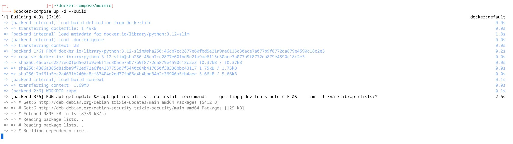
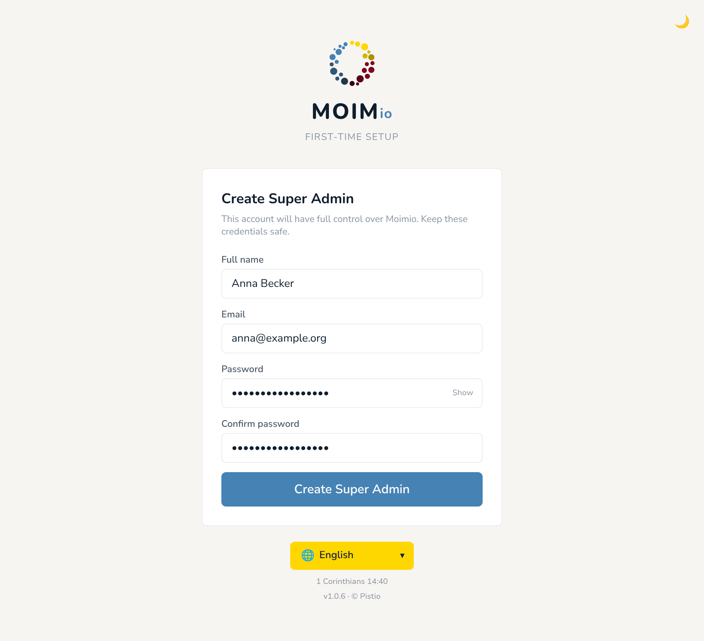

🌐 [English](quick-guide.md) · [Deutsch](quick-guide.de.md) · [한국어](quick-guide.ko.md) · [Español](quick-guide.es.md) · [Português (Brasil)](quick-guide.pt-BR.md) · **Français**

# Guide d’installation rapide

Pour les personnes à l’aise avec un terminal, Docker et un minimum d’administration système. Si ce n’est pas votre cas, le [guide pour débutants](beginner.fr.md) couvre le même terrain à un rythme plus lent, avec davantage d’accompagnement.

Temps nécessaire : **30 à 60 minutes**, d’un serveur vierge à la connexion d’un administrateur. L’essentiel de ce temps correspond au premier `docker compose up --build`, qui construit les deux images Moimio à partir des sources sur votre machine.

---

## Prérequis

- Une machine Linux (n’importe quelle distribution récente : Ubuntu 22.04+, Debian 12+, Fedora, toute distribution avec systemd).
- **Docker Engine 24+** et **Docker Compose v2** (la sous-commande `docker compose`, pas l’ancien binaire autonome `docker-compose`).
- **Git** (pour cloner), ou simplement télécharger et décompresser l’archive des sources.
- **Ports :** `6120` (frontend ; il relaie aussi `/api` et `/health` vers le backend, donc les navigateurs n’ont besoin que de celui-ci). Compose publie aussi `6121` (backend, pour un accès direct à l’API pendant le débogage) et `6122` (PostgreSQL). Aucun des deux n’a besoin d’être public ; voir « Changer les ports » ci-dessous pour les lier à localhost.
- Des droits `sudo` pour `upgrade.sh`, qui appelle `sudo docker compose`.
- Environ **2 Go de RAM** et **5 Go de disque** pour une installation à l’échelle d’une petite église.

Pour vérifier que Docker est prêt :

```bash
docker --version          # → Docker version 24.0+ ...
docker compose version    # → Docker Compose version v2.x.x
```

Si `docker compose version` échoue, vous avez l’ancien Compose autonome. Installez le plugin v2 : `apt install docker-compose-plugin` (Ubuntu/Debian) ou suivez les [instructions officielles de Docker](https://docs.docker.com/compose/install/).

---

## 1. Cloner et configurer

```bash
git clone https://github.com/pistio/moimio.git
cd moimio
cp .env.example .env
```

Ouvrez `.env` et modifiez au minimum les deux premières de ces variables :

| Variable | Valeur à définir |
|---|---|
| `SECRET_KEY` | Une chaîne aléatoire d’**au moins 64 caractères**. Générez-en une avec `python3 -c "import secrets; print(secrets.token_urlsafe(64))"` ou `openssl rand -hex 64`. **Ne laissez pas la valeur provisoire `change-me-...` en production.** |
| `POSTGRES_PASSWORD` | Un mot de passe aléatoire pour l’utilisateur de la base de données. Même méthode de génération. |
| `DATABASE_URL` | Facultatif. `docker-compose.yml` construit le `DATABASE_URL` du backend à partir de `POSTGRES_USER`, `POSTGRES_PASSWORD` et `POSTGRES_DB` : la ligne de `.env` n’est donc pas celle qu’utilise le conteneur. Mettez quand même à jour son mot de passe si vous tenez à un fichier cohérent. |

Définissez `POSTGRES_PASSWORD` **avant le premier démarrage.** Postgres ne l’applique qu’à la création initiale du volume `pgdata` ; le modifier ensuite provoque `password authentication failed` tant que vous ne le changez pas aussi dans la base de données.

Laissez `LOG_LEVEL=INFO` (valeur par défaut). Voir « Sécurisation pour la production » pour comprendre pourquoi.

Si vous voulez l’e-mail dès le départ, renseignez aussi le bloc SMTP : voir le tableau SMTP en bas de ce guide. Vous pouvez vous passer de SMTP ; l’application fonctionne sans (les e-mails de confirmation d’inscription ne sont simplement pas envoyés, et les administrateurs peuvent confirmer les inscriptions à la main).

### Changer les ports

Les valeurs par défaut sont 6120 (frontend), 6121 (backend), 6122 (Postgres). Si l’un d’eux est déjà utilisé sur votre machine, remplacez-le dans `.env` :

```
FRONTEND_PORT=7120
BACKEND_PORT=7121
DB_PORT=7122
```

`docker-compose.yml` lit ces valeurs via `${FRONTEND_PORT:-6120}` etc. : elles sont prises en compte sans autre modification. Vous ouvririez alors `http://localhost:7120` à la place.

Les valeurs sont insérées telles quelles dans la correspondance `ports:` de Compose : vous pouvez donc aussi indiquer une adresse. Ceci lie le port à la seule interface loopback de la machine :

```
BACKEND_PORT=127.0.0.1:6121
DB_PORT=127.0.0.1:6122
# Uniquement si votre reverse proxy ou votre tunnel tourne sur cette même machine :
FRONTEND_PORT=127.0.0.1:6120
```

Le navigateur communique avec le backend via le proxy `/api` du frontend : modifier `BACKEND_PORT` ne demande donc rien d’autre. (D’anciens fichiers `.env` peuvent encore contenir `VITE_API_URL` ; plus rien ne la lit, vous pouvez supprimer la ligne.)

---

## 2. Démarrer la pile



```bash
docker compose up -d --build
```

Le premier lancement télécharge les images et construit : comptez 3 à 5 minutes avec une connexion correcte. Les reconstructions suivantes sont plus rapides.

Suivez le démarrage du backend :

```bash
docker compose logs -f backend
```

Vous cherchez deux lignes de journal, dans cet ordre :

```
INFO  [alembic.runtime.migration] Running upgrade ... -> <latest migration>
INFO  Application startup complete.
```

La première signifie que le schéma de la base de données a bien été créé ou migré. La seconde signifie qu’uvicorn sert l’API. Si vous voyez la seconde sans la première, les migrations étaient déjà à jour : c’est très bien aussi. **Appuyez sur Ctrl-C pour arrêter de suivre le journal ; les conteneurs continuent de tourner.**

Testez rapidement l’API (le même point d’accès est aussi joignable via le frontend sur `http://localhost:6120/health`) :

```bash
curl http://localhost:6121/health
# → {"status":"ok","database":"healthy","version":"1.0.6"}
```

### À propos des migrations Alembic

Alembic est un outil de migration de base de données fourni avec SQLAlchemy. Il gère l’évolution du schéma : chaque fichier de migration est un ensemble de modifications versionné qui sait faire avancer la base de données (et, si possible, la faire reculer).

Deux choses bonnes à savoir :

- **Les migrations s’exécutent automatiquement à chaque démarrage du conteneur backend.** Le CMD du Dockerfile est `alembic upgrade head && uvicorn ...` : Alembic vérifie la révision actuelle de la base de données, applique les migrations plus récentes qu’il trouve, puis passe la main à uvicorn.
- **Les migrations n’effacent pas vos données.** Chaque migration est incrémentale : « ajouter cette colonne », « créer cette table », « renommer cet index ». Elles ne recréent jamais la base de données de zéro. Tant que vous ne lancez pas `docker compose down -v` (l’option `-v` supprime les volumes nommés, dont `moimio_pgdata`), les données de vos participants, vos événements et vos répartitions sont conservés d’une mise à jour à l’autre.

Si vous devez un jour réinitialiser la base de données, c’est `docker compose down -v` (cela supprime le volume `pgdata`, nommé `<project>_pgdata`, par exemple `moimio_pgdata`). Ne le faites que sur une installation sans vraies données.

---

## 3. Créer le premier administrateur



Moimio n’est pas livré avec un administrateur par défaut. Ouvrez `http://localhost:6120` (ou le port que vous avez configuré) dans un navigateur. Vous arrivez automatiquement sur un **écran de configuration initiale** : Moimio détecte qu’aucun utilisateur n’existe et propose l’assistant.

Renseignez :

- **Nom complet** : le nom affiché dans l’interface d’administration.
- **Adresse e-mail** : votre identifiant de connexion.
- **Mot de passe** et **Confirmer le mot de passe** : 8 caractères minimum. Utilisez un vrai gestionnaire de mots de passe.

L’écran comporte aussi un sélecteur de langue et un bouton mode clair/sombre. Cliquez sur **Créer le super administrateur**. Le compte est créé avec le rôle **Super administrateur**, et vous êtes redirigé vers la page de connexion pour vous connecter avec. L’écran de configuration ne réapparaît plus jamais dès qu’un utilisateur existe.

**Autre possibilité : l’initialisation en ligne de commande.** Pour les installations sans interface ou automatisées, la même opération est disponible en ligne de commande :

```bash
docker compose exec backend python -m app.cli.create_admin
```

Elle demande une adresse e-mail, un nom complet et un mot de passe, puis crée un super administrateur. La configuration à l’écran reste l’option recommandée pour l’auto-hébergement. La ligne de commande est aussi le moyen de reprendre la main si vous perdez le mot de passe du seul super administrateur et n’avez pas de SMTP pour le réinitialiser : créez un second super administrateur avec une autre adresse e-mail.

---

## 4. Se connecter (après la configuration)

Connectez-vous sur `http://localhost:6120/login` avec le compte que vous venez de créer.

Tant qu’il n’y a aucun événement, vous arrivez sur l’écran **Bienvenue sur Moimio** ; cliquez sur **Créer votre premier événement**. Une fois des événements créés, la liste des événements propose un bouton **+ Nouvel événement**.

En tant que super administrateur, ouvrez aussi **Espace de travail** dans la barre latérale et renseignez votre **URL de la politique de confidentialité**. Le formulaire d’inscription public y renvoie juste après la phrase de consentement ; laissez le champ vide et aucun lien n’apparaît.

---

## 5. Sécurisation pour la production

Avant d’exposer Moimio sur l’internet public :

- Placez un reverse proxy avec terminaison TLS devant le port 6120. Caddy, Traefik ou un Cloudflare Tunnel sur la machine fonctionnent très bien ; Nginx + Let’s Encrypt est l’option classique.
- C’est aussi le HTTPS qui fait fonctionner certaines fonctionnalités de l’application. Les navigateurs n’enregistrent le service worker qu’en HTTPS ou sur `localhost` : une installation ouverte via une adresse réseau local en HTTP simple, comme `http://192.168.1.20:6120`, n’a ni cache hors ligne, ni invite « nouvelle version disponible », ni rien à vider pour le bouton « Vider le cache et recharger », et aucun message d’erreur n’en explique la raison.
- Gardez le port du backend (6121) et celui de la base de données (6122) hors de l’internet public. Liez-les à localhost dans `.env` (voir « Changer les ports »). Une règle de pare-feu sur la machine ne suffit pas : les ports publiés par Docker sont ouverts dans iptables par Docker lui-même et contournent les règles `ufw`/`firewalld`.
- Lisez [`SECURITY.md`](../../SECURITY.md) (en anglais) : la section « Hardening recommendations for self-hosters » couvre le reste (SECRET_KEY robuste, rotation du mot de passe de la base de données, mises à jour de la machine Docker, bonnes pratiques pour les identifiants SMTP).
- Laissez `LOG_LEVEL=INFO` sur toute installation qui contient de vrais participants. `LOG_LEVEL=DEBUG` écrit les noms, adresses et dates de naissance des participants dans le journal du conteneur à chaque requête ; déboguez plutôt sur une copie avec des données inventées.

---

## 6. Mettre à jour

Depuis la racine de votre clone git :

```bash
./upgrade.sh                # dernier commit de votre branche actuelle
./upgrade.sh v1.0.6         # un tag de version précis (voir CHANGELOG.md)
./upgrade.sh v1.0.6 --yes   # sans demande de confirmation
./upgrade.sh --dry-run      # montre ce qui se passerait, sans rien modifier
```

Le script vérifie d’abord (présence de `.env`, arbre de travail propre, conteneur `db` en marche), affiche les commits qu’il va appliquer, sauvegarde `.env` dans `.env.pre-upgrade-<timestamp>.bak` et la base de données dans `../pgdata-pre-upgrade-<timestamp>.sql.gz`, puis bascule sur la cible et lance `docker compose down`, `build --no-cache` et `up -d`. Il affiche à la fin les commandes exactes de retour en arrière. Gardez les sauvegardes jusqu’à ce que la nouvelle version vous donne satisfaction. Basculer sur un tag laisse le clone en « detached HEAD » : une fois une version fixée, indiquez aussi explicitement la suivante (`./upgrade.sh v1.0.7`) plutôt que de lancer le script sans argument.

Après le redémarrage, le script attend jusqu’à 90 secondes que le conteneur backend se déclare « healthy ». Le healthcheck du backend dans `docker-compose.yml` appelle `/health` toutes les 10 secondes après une période de démarrage de 30 secondes. Si l’attente se termine par un avertissement « did not become healthy » (par exemple à cause d’une longue migration), vérifiez `curl http://localhost:6121/health` et le journal du backend avant de revenir en arrière.

L’équivalent manuel, si vous préférez :

```bash
git pull            # ou : git fetch --tags && git checkout v1.0.6
docker compose build --no-cache
docker compose up -d --force-recreate
```

`--no-cache` est important quand le Dockerfile change (nouvelles dépendances, installation de polices, etc.). Sans lui, vous risquez de faire tourner du nouveau code sur une ancienne couche d’image et de tomber sur des pannes déroutantes.

Les migrations s’exécutent automatiquement au démarrage du backend : aucune étape manuelle `alembic upgrade head` n’est nécessaire. Vos données sont conservées d’une mise à jour à l’autre (le volume `pgdata` n’est pas touché). Faites quand même une sauvegarde avant, comme pour toute mise à jour.

`deploy.sh`, à la racine du dépôt, est un outil différent : il remplace l’installation à partir d’un paquet `../moimio-ce-<tag>.zip` et s’adresse aux installations qui n’ont pas été faites avec `git clone`. Si vous avez cloné le dépôt, utilisez `upgrade.sh`.

### Images de conteneur

Ce guide construit les images à partir des sources. Chaque version est aussi publiée sous `ghcr.io/pistio/moimio-backend:<tag>` et `ghcr.io/pistio/moimio-frontend:<tag>` (par exemple `v1.0.6`). Si vous les utilisez, fixez toujours un tag de version : `:latest` est figé sur v1.0.6, n’évolue plus et n’est pas pris en charge. `backend/deploy/production.yml` est le modèle du service hébergé, pas un fichier compose pour l’auto-hébergement ; utilisez le `docker-compose.yml` à la racine.

---

## 7. Sauvegardes

La sauvegarde la plus simple est un `pg_dump` de Postgres :

```bash
docker compose exec -T db pg_dump -U moimio moimio | gzip > moimio-backup-$(date +%F).sql.gz
```

Lancez-la via une tâche cron. Stockez les exports ailleurs que sur la machine.

Pour restaurer, chargez l’export dans une base de données vide (un export simple injecté dans une base déjà remplie échoue sur les tables et les lignes existantes) :

```bash
docker compose stop backend
docker compose exec -T db dropdb -U moimio moimio
docker compose exec -T db createdb -U moimio moimio
gunzip -c moimio-backup-2026-10-01.sql.gz | docker compose exec -T db psql -U moimio moimio
docker compose start backend
```

(Remplacez par vos `POSTGRES_USER` / `POSTGRES_DB` si vous les avez modifiés.)

Le produit propose aussi une sauvegarde par événement, dans l’application : la page **Sauvegarde** de la barre latérale télécharge un ZIP par événement (complet, ou structure seule sans données personnelles), et **Restaurer depuis une sauvegarde** le fait revenir sous forme de nouvel événement en brouillon, sur cette installation ou une autre. Les membres de l’équipe et leurs rôles ne sont pas inclus dans une sauvegarde ; invitez de nouveau l’équipe sur le serveur de destination. Voir la [section 09 du manuel d’utilisation](../manual/09-data-export-gdpr.fr.md).

Pour une archive de tout l’espace de travail en ligne de commande : `docker compose exec backend python -m app.cli.export_all --out /tmp/moimio-export.zip`.

Pour rapatrier tout un espace de travail sur ce serveur, tous les événements d’un coup, voir [Moving a workspace to your own Moimio](../moving-a-workspace.md) (en anglais).

---

## Référence SMTP (facultatif)

Si vous voulez les e-mails de confirmation d’inscription et la réinitialisation des mots de passe, remplissez le bloc SMTP dans `.env` :

```
SMTP_HOST=smtp.yourprovider.com
SMTP_PORT=587
SMTP_USER=events@yourchurch.org
SMTP_PASSWORD=your-app-password
SMTP_FROM_EMAIL=events@yourchurch.org
SMTP_FROM_NAME=Your Church Events
SMTP_TLS=true
SMTP_SSL=false
```

`SMTP_TLS=true` correspond à STARTTLS (port 587). Pour du TLS implicite sur le port 465, indiquez `SMTP_PORT=465`, `SMTP_SSL=true` et `SMTP_TLS=false`. L’e-mail n’est activé que si `SMTP_HOST` et `SMTP_USER` sont tous deux renseignés. Redémarrez le backend après toute modification (`docker compose up -d backend`).

Fournisseurs courants et leurs réglages habituels (vérifiez dans la documentation actuelle du fournisseur : ces réglages changent de temps en temps) :

| Fournisseur | Hôte habituel | Port habituel | Remarques |
|---|---|---|---|
| Zoho Mail | `smtp.zoho.eu` / `smtp.zoho.com` | 587 | Générez un mot de passe d’application sous Account → Security |
| Gmail / Google Workspace | `smtp.gmail.com` | 587 | Nécessite la validation en deux étapes + un mot de passe d’application |
| Brevo (anciennement Sendinblue) | `smtp-relay.brevo.com` | 587 | L’offre gratuite couvre la plupart des volumes d’une petite église |
| SMTP2GO | `mail.smtp2go.com` | 587 | Paiement à l’usage, avec une offre gratuite |
| Mailgun | `smtp.mailgun.org` | 587 | Nécessite une vérification du domaine |

**Consultez toujours la documentation SMTP actuelle de votre fournisseur** avant de configurer : les réglages, numéros de port et exigences d’authentification évoluent. C’est la page d’état du fournisseur qui fait foi, pas ce tableau.

Testez depuis l’interface après avoir créé un événement : ouvrez les réglages du formulaire d’inscription de l’événement (**Configuration ▸ Inscription** tant que l’événement est en configuration, **Plus ▸ Formulaire d’inscription** une fois les inscriptions ouvertes), puis **Confirmation par e-mail ▸ Envoyer un e-mail de test**. L’e-mail de test est envoyé à votre propre adresse de connexion et indique quels nom d’expéditeur (`From`), adresse `Reply-To` et serveur SMTP ont été utilisés : très utile pour diagnostiquer les cas « l’e-mail n’est jamais arrivé ».

Si SMTP n’est pas renseigné, l’application n’envoie rien et consigne `email_skipped` pour chaque envoi qui aurait eu lieu. Pratique pour le développement.

---

## Référence des réglages facultatifs

Tous ces réglages sont lus depuis `.env` et transmis par `docker-compose.yml`. Redémarrez avec `docker compose up -d` après les avoir modifiés.

| Variable | Par défaut | Effet |
|---|---|---|
| `LOG_LEVEL` | `INFO` | `DEBUG` consigne chaque requête de base de données avec ses valeurs, c’est-à-dire les données des participants. |
| `RATE_LIMIT_REGISTRATION` | `60` | Inscriptions par minute depuis une même adresse. Chaque membre de famille supplémentaire sur le formulaire compte. Augmentez-le si toute une assemblée s’inscrit en même temps via un seul Wi-Fi ; `0` le désactive. Derrière votre propre reverse proxy ou un Cloudflare Tunnel, c’est la véritable adresse du visiteur qui est utilisée, à condition que ce proxy atteigne Moimio depuis une adresse privée ou loopback et envoie `X-Forwarded-For`. |
| `FEATURE_ALLOCATION` | `true` | `false` désactive le moteur de répartition, pour une installation limitée aux inscriptions. |
| `FEATURE_OUTBOUND_WEBHOOKS` | `true` | `false` masque la page Webhooks et désactive les envois. Voir [webhooks](../webhooks.md) (en anglais). |
| `WEBHOOK_ALLOW_PRIVATE_TARGETS` | `false` | Les URL de webhook sur des adresses privées, loopback ou link-local (`10.x`, `192.168.x`, `localhost`…) sont refusées sauf si cette valeur est `true`. Ne l’activez que si votre récepteur se trouve sur votre propre réseau. Absente de `.env.example` ; ajoutez la ligne vous-même. |
| `WEBHOOK_DELIVERY_RETENTION_DAYS` | `30` | Durée de conservation de l’historique des envois de webhooks. |

Les autres variables de `.env.example` et de `docker-compose.yml` (`FEATURE_CREATE_EVENT_CONFIRMATION`, `EVENT_CHARGE_*`, `BILLING_CARD_LAST4`, `FEATURE_ACCOUNT_PORTAL`, `ACCOUNT_URL`, `FEATURE_DEMO_NOTICE`, `MOIMIO_DEMO_MAIL_URL`, `MOIMIO_TENANT_ID`, `MOIMIO_WEBHOOK_URL`, `MOIMIO_WEBHOOK_SECRET`) existent pour le service hébergé et ses espaces de démonstration. Laissez-les à leurs valeurs par défaut sur une installation auto-hébergée normale. `APP_URL` n’est plus utilisée : les liens des e-mails tirent leur adresse de la requête.

---

## Dépannage

**`docker compose up` s’arrête immédiatement, sans journaux.**
Regardez l’erreur réelle : `docker compose ps` puis `docker compose logs <service>`. La cause la plus fréquente est un conflit de ports : quelque chose d’autre sur la machine utilise déjà 6120, 6121 ou 6122. Arrêtez le service en conflit ou changez le port (voir « Changer les ports » plus haut).

**Les journaux du backend indiquent `connection refused` vers `db:5432`.**
Le backend a démarré avant que Postgres soit prêt. La clause `depends_on: condition: service_healthy` l’empêche normalement ; si vous voyez ce message, votre version de Docker est peut-être trop ancienne. Mettez Docker à jour, ou lancez simplement `docker compose restart backend`.

**Les journaux du backend indiquent `relation "users" does not exist`.**
Les migrations Alembic ne se sont pas exécutées. Cherchez une erreur Alembic plus haut dans `docker compose logs backend`. La solution est généralement `docker compose down && docker compose up -d --force-recreate`.

**La page indique « Cannot reach the server », ou la connexion échoue avec une erreur réseau.**
Le conteneur frontend sert la page et relaie `/api/*` vers le conteneur backend. Vérifiez que le backend tourne (`docker compose ps`, puis `docker compose logs backend`) et que `curl http://localhost:6120/health` répond. Si vous avez placé votre propre reverse proxy devant, assurez-vous qu’il transmet tous les chemins au port 6120, pas seulement `/`.

**Les journaux du backend indiquent `password authentication failed for user "moimio"`.**
`POSTGRES_PASSWORD` a été modifié après la création initiale du volume de la base de données ; Postgres conserve le mot de passe d’origine. Remettez l’ancien mot de passe dans `.env`, ou changez-le dans la base de données (`docker compose exec db psql -U moimio -c "ALTER USER moimio PASSWORD '<new>'"`) et redémarrez.

**Tout autre problème.**
Ouvrez un [rapport de bug](https://github.com/pistio/moimio/issues/new?template=bug_report.md) avec les journaux pertinents (en masquant d’abord toute donnée de participant).

---

Prêt à utiliser Moimio ? Commencez par le [manuel d’utilisation](../manual/README.fr.md) pour découvrir comment organiser un événement.
