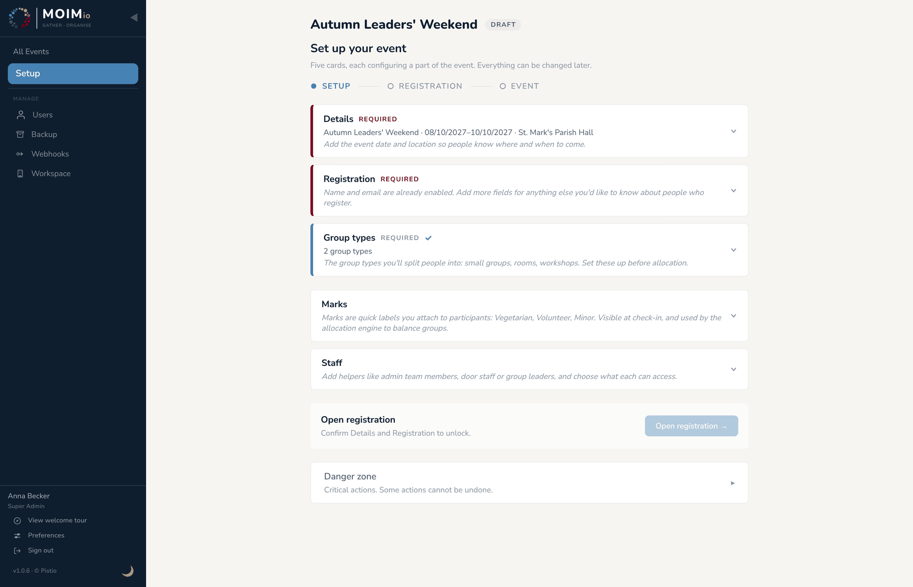
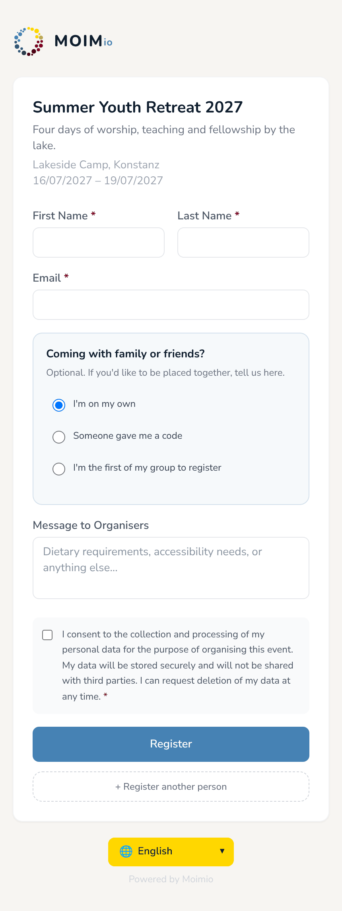

🌐 **English** · [Deutsch](02-events-and-registration.de.md) · [한국어](02-events-and-registration.ko.md) · [Español](02-events-and-registration.es.md) · [Português (Brasil)](02-events-and-registration.pt-BR.md) · [Français](02-events-and-registration.fr.md)

# 02 — Events and Registration

How to create an event, fill in its details, configure its registration form, open it for sign-ups, and keep an eye on incoming registrations.

---

## Creating an event

From the events list, click **+ New Event**. The **Create event** form is intentionally minimal:

- **Event name** — appears at the top of the registration form and in your events list. Keep it human ("Spring Retreat 2026" rather than "SR2026-EVENT-001").
- **Transfer settings from another event** (optional, shown once you have at least one event) — tick it, choose the event to copy from, then choose **What to copy**: **Marks**, **Registration form**, **Custom fields**, **Group types** (with their rooms and groups) and **Team members**. All five are ticked to start with; untick anything you don't want. Only setup is copied — never participants, allocations, check-ins or notes.

Click **Create event**. The event is created as a draft and you land on the **Setup hub**.

If you started from scratch (no settings transferred), two group types are already waiting for you: **Room Allocation** and **Small Groups**. (They appear in your interface language, and you can rename or delete them.) If you transferred group types from another event, you get those instead.

Everything else — dates, location, description, timezone, registration form fields, groups, marks, staff — is configured next, on the Setup hub.

> **Restoring instead of creating.** If you have a Moimio backup file of an earlier event, **↑ From backup** next to **+ New Event** recreates it as a new draft event.

---

## The Setup hub

   
  
   
  <em>Setup hub with the five configuration cards</em>

Five cards, each one a configuration area. Click a card to open it.

| Card | What it covers |
|---|---|
| **Details** | Event name, description, location, start and end dates, timezone. |
| **Registration** | The public registration form — which built-in fields to show, and your own custom fields. |
| **Group types** | The ways you'll split people up: rooms, small groups, workshops (covered in [section 5](05-group-types-and-units.md)). Comes with **Room Allocation** and **Small Groups**. The individual rooms and groups inside each type are added later from **Organise**, not from this card. |
| **Marks** | Optional. Colour-coded labels such as "Vegetarian" or "Leader" (covered in [section 4](04-marks.md)). |
| **Staff** | Optional. Add other users to the event and choose what they can access (covered in [section 11](11-staff-permissions.md)). |

The **Details** and **Registration** cards each have a **Save & confirm** button at the bottom. **Both must be confirmed** before you can open registration. The **Registration** card can only be confirmed while the event has at least one group type — as the two defaults are there from the start, this only matters if you've deleted them all.

Confirming isn't a one-way door: **Unconfirm** reopens a card for changes, and you can confirm it again afterwards. The extra step simply stops you opening registration with a half-built setup.

> **Dates and times.** Dates appear in the date format you picked in **Preferences**; the date picker itself follows your browser. Times are shown on a 24-hour clock in the event's own timezone.

---

## Configuring the registration form

Open the **Registration** card.

### Built-in fields

**First Name**, **Last Name**, **Email** and the **consent** checkbox are always on the form and can't be switched off. Under **Built-in Fields** you can add more, each with two checkboxes:

- **Show** — the field appears on the form.
- **Required** — the field must be filled in (only available when **Show** is ticked).

Changes save automatically.

| Field | Notes |
|---|---|
| Gender | The registrant picks **Male** or **Female**. The allocation engine uses this for groups restricted to one gender. |
| Date of Birth | Useful for retreats with age-based groups. |
| Phone | |
| Address | |
| Country | Useful for international events. |
| Church / Organisation | Useful when participants come from several churches or organisations. |

Every form also has an optional **Message to Organisers** box (for dietary needs, accessibility and the like) and a consent checkbox. If a Super Admin has set a **Privacy notice URL** under **Manage ▸ Workspace**, a **Privacy notice** link appears right after the consent sentence.

### Custom fields

For anything the built-ins don't cover, click **+ Add Field** under **Custom Fields**. Choose:

- **Field label** — what the registrant sees ("T-shirt size", "Have you been before?").
- **Type** — **Text**, **Number**, **Dropdown**, **Yes/No**, **Date** or **Info text**.
- **Required** — whether it must be filled in.
- **Options** — for **Dropdown**, the choices separated by commas (e.g. `S, M, L, XL`).
- **Show on registration form** — untick this for a field only your team fills in (it still appears in the People table).

Click **Add Custom Field** to save it.

Common custom fields:

- "T-shirt size" (Dropdown: XS, S, M, L, XL, XXL)
- "Are you a small-group leader?" (Yes/No)
- "First time at this event?" (Dropdown: Yes, No, I've been once)
- "Dietary requirements" (Text or Dropdown, depending on how fixed your menu is)
- "Photo consent" (Yes/No, for use of the participant's image in event photos)

Custom fields belong to one event — adding "T-shirt size" here doesn't add it to your other events. You can edit or delete a field after registrations have come in, but **deleting a field also deletes every answer already given to it**.

> **Reusing a form.** The **⋯** menu at the top of the card has **Export form** and **Import form**, so you can save a form to a file and load it into another event (or another Moimio installation). Importing never creates duplicates of fields you already have.

#### Info texts

An **Info text** is a note from you on the form, such as directions or a reminder. Nobody fills it in, so it has no **Required** box. Give it a heading and the text. Line breaks are kept. For a link, paste the web address, or write `[link text](https://example.org/form.pdf)` to show your own wording. Links open in a new tab.

#### Showing a field only when it applies

Tick **Show only if…** on a field to show it only when an earlier answer matches:

- a **Yes/No** field above it has the answer you pick. Example: "Teamer" is **Yes**, then "Which team?" appears.
- a **Dropdown** field above it has one of the options you tick.
- the person is under an age you set, using **Date of Birth**. Age is counted on the event's start date, or on the day of registration if the event has no start date. **Date of Birth** must be switched on under the built-in fields.

A hidden field is never required, and an answer typed before the field was hidden again is not saved. Each extra person on a family registration is checked on their own: a 15-year-old sees the note for under-18s, their parent does not.

An **Info text** with a condition also gets a column in **People** (ticked to start with) and at **Check-in** (switch it on under **Columns**). It reads **Applies** for everyone the note was meant for, so the desk can see who has to bring, for example, a signed consent form. If you correct someone's date of birth, or change the event's start date, the column follows.

Use **↑** and **↓** to change the order of your custom fields. A field can only depend on a field above it, so a move that would break this is refused with a message. For the same reason, a field that another field depends on can't be deleted until that condition is removed.

### Group codes: keeping families and friends together

Every form has a **Coming with family or friends?** section. Registrants choose one of:

- **I'm on my own.**
- **I'm the first of my group to register** — Moimio creates a new group code for them (based on their surname, e.g. `SMITH-742`) and puts it in their confirmation email so they can pass it on.
- **Someone gave me a code** — they type in the code they were given (e.g. `KIM-104`) and are placed with that group.
- **Yes, but I don't have a code, just their name** — only shown if you've switched on **Allow group preferences** (see below). They type a name and details, and you match people up by hand.

Everyone who shares a group code forms a group the allocation engine tries to keep together. See [section 5](05-group-types-and-units.md) for the full mechanics.

Group codes look like `STEM-NNN`: up to eight letters from the surname (or a name the registrant chooses), a dash, and a number. Accents are dropped, so Müller becomes `MULLER` and García becomes `GARCIA`; a surname with no Latin letters (for example 김) gets `GROUP`. Even someone who registers on their own gets a code, normally with a three-digit number (longer only if many people in the event share that surname). When registering several people at once, each extra person can share the first person's code (recommended for families), have none, or use a different one.

---

## Opening registration

At the bottom of the Setup hub sits the **Open registration** box. Until both **Details** and **Registration** are confirmed it says *"Confirm Details and Registration to unlock."* and the button is greyed out. Once they are, it changes to **Ready to open registration →**. Click it.

The event moves from draft to open, you're in **Registration phase**, and the public registration form is live.

To find the public link, click **Share form** at the top of the **Registration** page (the first item in the sidebar). You'll see:

- A QR code for posters and printed bulletins.
- The **Form link** (e.g. `https://events.yourchurch.org/register/abc-123-def`), with **Copy** and **Open ↗** buttons.
- **Share…**, on phones and tablets, to send it straight to a messaging app.

Share this link however you reach your participants — email, parish bulletin, WhatsApp group, your church website. It stays the same for the lifetime of the event. To embed the form in your website instead, use the **Embed Code** under **More ▸ Registration form ▸ Share registration**.

### Settings that become available after opening

Once registration is open, **More ▸ Registration form** holds everything from the Registration card plus a few extras:

- **Allow group preferences** — lets registrants name people they'd like to be with even without a group code. You review these requests yourself before allocating.
- **Customise Appearance** — **Open Customiser** to change the form's colours, font and corner style.
- **Email confirmation** — **Require email confirmation for registration** (off by default), the **Email "From" display name**, the **Reply-To email address**, and **Send Test Email** to check that email works. Click **Save email settings** after changing them.

If you want email confirmation, switch it on straight after opening — before you share the link.

### Watching sign-ups

The **Registration** page shows how many people have **Registered**, with **Confirmed**, **Pending** and **Cancelled** counts, a chart of sign-ups over the last **7 days**, **30 days** or **Since opening**, a **Needs attention** box (for example people who haven't confirmed their email yet) and a list of **Recent sign-ups**. It updates by itself as people register — no need to refresh. **View all participants** takes you to the People table ([section 03](03-people.md)).

---

## What participants see when they register

  
   
  <em>Public registration form</em>

Participants land on a clean form showing your event's name, description, location and date. They:

1. Pick their language with the 🌐 picker at the bottom of the page if needed (the form comes in the same six languages as the admin area).
2. Fill in the fields you configured, and choose an option under **Coming with family or friends?**.
3. Tick the consent box (and can open your **Privacy notice**, if you've set one).
4. Click **Register**.

To sign up several people in one go (a family, a youth group), they click **+ Register another person**. Each extra person gets their own card, with a **Copy details from …** shortcut, and the button becomes **Register 2 people** (3, 4, …).

If something is missing or wrong, the form says so in the registrant's own language, right beside the box that needs fixing.

What happens next depends on your **Email confirmation** setting:

- **Off (the default).** The registration is **confirmed** straight away. They see **Registration Complete**, and receive an email with their group code (if your server can send email).
- **On.** The registration starts as **pending**. They see **Check Your Email**, and receive an email with a confirmation link. When they click it, the registration becomes **confirmed**, they see **Confirmed!**, and they receive a second email with their group code.

If your server isn't set up to send email (SMTP) and confirmation is switched on, the emails are silently skipped and those registrations stay **pending**, because nobody can click a link they never received. Either confirm them by hand on the People page, or switch on **Include unconfirmed people** in the allocation engine settings. If someone's email went missing, the People page also has a **Resend** button that sends the registration email again.

---

## Closing registration

Registration **does not close automatically** when the start date arrives. You always close it yourself.

- **During Registration phase:** click **Close registration →** on the **Registration** page.
- **Once the event has started:** a **Registration is still open** banner appears at the top of **Organise** — *"People can still sign up while the event is underway."* — with a **Close registration** button.

After closing, the banner at the top of **Organise** reads **Registration is closed**, with a **Re-open registration** button. You can re-open at any time, even after the event has started — handy for late arrivals or day guests who register at the door.

While registration is closed, anyone who tries to submit the form is told *"Registration is not open for this event."*

---

## Common mistakes during this phase

- **Forgetting to confirm the Details card.** People set up the registration form, click **Save & confirm**, and wonder why the open-registration button stays greyed out. Both **Details** and **Registration** must be confirmed.
- **Adding required custom fields after registration is open.** People who already registered won't have answered them. New registrations work fine, but you'll need to chase earlier ones for the missing information.
- **Not testing the email flow.** Before sharing the link widely, use **More ▸ Registration form ▸ Email confirmation ▸ Send Test Email** to check email works, then fill in your own form for a full end-to-end test.

---

## What's next

[Section 03 — People](03-people.md) covers what to do with registrations once they start coming in: the People table, statuses, edits, manual confirmations, and group codes from the admin side.
