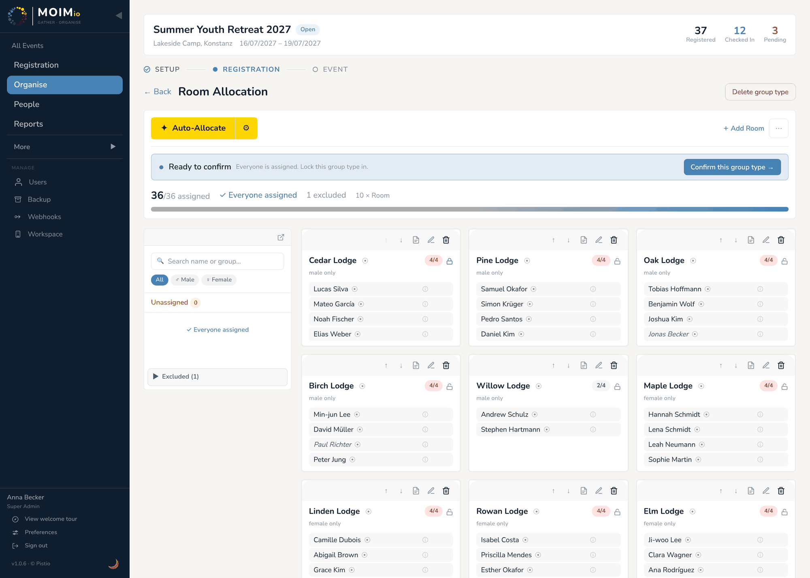
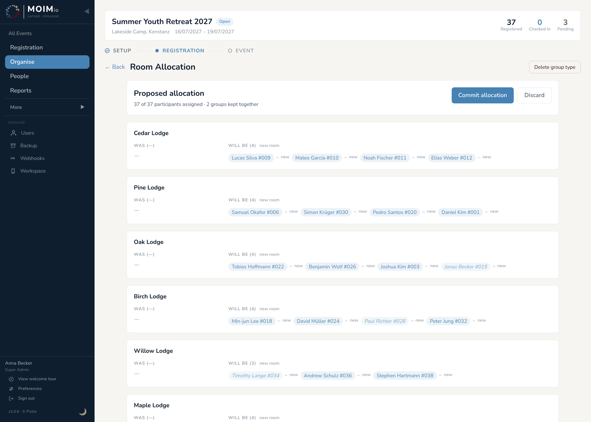
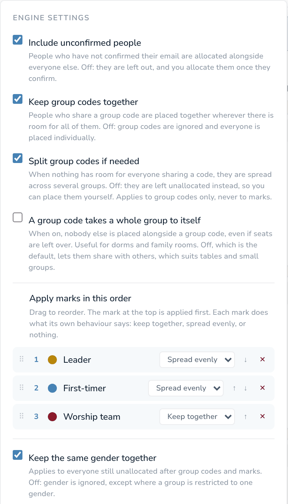

🌐 [English](06-allocation-engine.md) · [Deutsch](06-allocation-engine.de.md) · [한국어](06-allocation-engine.ko.md) · [Español](06-allocation-engine.es.md) · **Português (Brasil)** · [Français](06-allocation-engine.fr.md)

# 06 — Motor de atribuição

O motor de atribuição é o que diferencia o Moimio de uma planilha. Quando as inscrições chegam, o motor propõe uma atribuição completa com um clique, respeitando códigos de grupo, marcações, restrições de gênero e por marcação, exclusões e a capacidade dos grupos. Você revisa a proposta e depois a confirma ou descarta.

Esta seção explica como rodá-lo, o que ele faz, como ajustá-lo e o que fazer quando a proposta não está exatamente como você queria.

  
   
  <em>O quadro de atribuição de um tipo de grupo, no meio da atribuição</em>

---

## Onde encontrá-lo

**Atribuição**, na barra lateral ▸ clique no cartão de um tipo de grupo (por exemplo, **Atribuição de quartos** ou **Grupos pequenos**). Isso abre o quadro de atribuição daquele tipo de grupo. **← Voltar** retorna à lista de tipos de grupo.

O quadro tem três partes:

- **Barra de ferramentas superior**: o botão **✦ Atribuir automaticamente**, com um **⚙** (configurações do motor) ao lado, um link **+ Adicionar [item]** para criar um novo grupo (por exemplo, **+ Adicionar Quarto**) e um menu **⋯** (notas, **↗ Abrir visão geral**, downloads de PDF, **Limpar todas as alocações**).
- **Painel esquerdo, Não atribuídos**: todos que ainda não estão em um grupo, com uma caixa de busca e os filtros **Todos / ♂ Masculino / ♀ Feminino**. Quem ainda não confirmou o e-mail aparece com a etiqueta **Pendente**. Abaixo da lista fica o bloco **Não incluídos** (veja [Como deixar alguém de fora de um tipo de grupo](#como-deixar-alguém-de-fora-de-um-tipo-de-grupo)). O painel pode virar uma janela flutuante e voltar ao lugar pelo pequeno ícone no topo dele.
- **Grade à direita, os grupos**: um cartão por grupo, com a ocupação (por exemplo, `5/8`), a restrição de gênero, se houver (por exemplo, **Apenas mulheres**), um pontinho colorido se o grupo for reservado para quem tem uma marcação, e as pessoas que estão nele.

**Atribuição manual.** No computador, arraste uma pessoa do painel esquerdo para o cartão de um grupo, ou de um grupo para outro. No celular ou tablet, toque nas pessoas para selecioná-las e depois toque no cartão de um grupo (ou use **Atribuir a →** na barra inferior da tela). Para tirar alguém de um grupo, passe o mouse sobre o nome e clique no ✕ vermelho (**Remover atribuição**), ou arraste a pessoa de volta para o painel esquerdo.

As movimentações manuais são salvas na hora. Se soltar alguém deixaria um grupo acima da capacidade, o Moimio pergunta antes (**Exceder capacidade**). A restrição de gênero de um grupo não pode ser contornada manualmente.

---

## Como rodar o motor

Clique em **✦ Atribuir automaticamente**. Um pequeno menu **Modo de atribuição** se abre com duas opções:

- **Atribuir apenas novos participantes**: mantém todas as atribuições existentes neste tipo de grupo e só distribui quem ainda não está em nenhum grupo. Use quando você já colocou algumas pessoas manualmente e quer que o motor complete o resto.
- **Reatribuir todos do zero**: ignora as atribuições atuais e calcula uma atribuição nova para todos. Use quando você mudou as configurações do motor ou as marcações e quer uma proposta limpa.

Nos dois casos, os grupos que você bloqueou com **Manter** ficam exatamente como estão (veja [Como bloquear um grupo](#como-bloquear-um-grupo-manter)).

### Como revisar a proposta

Depois de um instante, o quadro é substituído pela tela **Atribuição proposta**. Nada foi salvo ainda, e os outros organizadores não veem a sua proposta.

  
   
  <em>Revisando uma proposta antes de confirmá-la</em>

- Uma linha de resumo no topo, por exemplo *"31 de 34 participantes atribuídos · 3 grupos mantidos juntos · 2 grupos divididos · 2 grupos formados por marcas"*.
- **N não puderam ser atribuídos**: quem o motor não conseguiu encaixar em lugar nenhum.
- Para cada grupo, uma coluna **Antes** (quem está nele agora) e uma coluna **Depois** (quem o motor propõe), com as pessoas marcadas como **novo** ou **saindo** e uma contagem de mudanças, como **+2** ou **sem alteração**.

**Por que esta pessoa está aqui?** Passe o mouse sobre qualquer nome (ou toque nele, no celular) para ver o motivo do motor, por exemplo *"atribuído com o código de grupo SMITH (4 pessoas)"*, *"seria distribuído porque esta marcação está configurada para distribuir uniformemente"* ou *"seria movido para equilibrar o tamanho dos grupos"*. Para quem não pôde ser atribuído, o motivo explica o que impediu.

Depois escolha:

- **Confirmar atribuição**: salva a proposta. O quadro volta, mostrando as novas atribuições.
- **Descartar**: joga a proposta fora depois de uma confirmação (*"Descartar a proposta? As sugestões do motor serão perdidas."*). As atribuições que você já tinha ficam intactas. O botão **← Voltar** do quadro faz a mesma pergunta enquanto houver uma proposta aberta.

Não dá para arrastar pessoas na tela de revisão. Se a proposta estiver quase certa, confirme-a e depois faça os ajustes no quadro.

---

## O que o motor faz, em linguagem simples

O motor segue estas etapas, nesta ordem. Elas correspondem à ordem das opções nas configurações do motor, então ler o painel de configurações de cima para baixo é ler a própria atribuição.

**Antes de tudo: quem participa.** Pessoas canceladas nunca entram. Pessoas não confirmadas (pendentes) entram, a menos que você desative **Incluir participantes não confirmados**. Quem você **não incluiu** neste tipo de grupo fica totalmente de fora. As pessoas em grupos bloqueados (**Manter**) ficam onde estão, e ninguém novo é adicionado a esses grupos.

**Etapa 1: códigos de grupo.** Pessoas que compartilham um código de grupo (famílias, amigos que se inscreveram juntos) são colocadas juntas, começando pelos grupos maiores. Cada um vai para o menor grupo capaz de receber todos. Se nenhum grupo for grande o bastante, eles são divididos da forma mais equilibrada possível entre o menor número de grupos capazes de recebê-los, desde que **Dividir códigos de grupo se necessário** esteja ativado. Se **Um código de grupo ocupa um grupo inteiro** estiver ativado, ninguém mais é colocado em um grupo onde um código de grupo foi parar. Um "código de grupo" usado por uma única pessoa não tem nada para manter junto, então essa pessoa é tratada como todo mundo.

**Etapa 2: marcações, na sua ordem.** O motor percorre a sua lista de marcações de cima para baixo. Para cada marcação:

- **Manter juntos**: as pessoas com aquela marcação vão para o mesmo grupo. Se não couberem todas, o motor enche um grupo por completo antes de começar o próximo, de modo que no máximo um grupo fica misturado.
- **Distribuir uniformemente**: as pessoas com aquela marcação são distribuídas uma a uma entre os grupos, para que nenhum grupo fique com várias delas. Útil para "um líder por grupo pequeno".
- **Sem efeito**: a marcação é ignorada aqui.

Quem foi colocado pelo código de grupo na etapa 1 não é movido por causa das suas marcações. Quem tem várias marcações é tratado pela que estiver mais alta na lista.

**Etapa 3: grupos com restrição.** Os grupos restritos a um único gênero ou a quem tem uma marcação (por exemplo, um quarto reservado para líderes) são preenchidos com as pessoas que atendem à restrição.

**Etapa 4: todos os outros.** Quem ainda está esperando é distribuído, por vez, entre os grupos restantes sem restrição. Com **Manter juntas as pessoas do mesmo gênero** ativado, o gênero é levado em conta aqui; com a opção desativada, o gênero é ignorado, exceto nos grupos com restrição.

**Etapa 5: equilíbrio.** Com **Equilibrar o tamanho dos grupos** ativado (o padrão), o motor então move códigos de grupo inteiros, grupos inteiros de marcações "manter juntos" e pessoas individuais entre os grupos, para que todos os grupos fiquem mais ou menos igualmente cheios em relação ao tamanho. Ele nunca separa um código de grupo para isso, e não mexe em quem foi dividido entre grupos, distribuído por uma marcação ou colocado em um grupo com restrição. Um grupo sem limite de capacidade é tratado como um grupo de tamanho médio.

**Etapa 6: preencher lacunas.** Quem ainda está sem lugar é colocado no grupo adequado com mais vagas sobrando.

**Etapa 7: explicar o resto.** Quem continua sem lugar recebe um motivo, mostrado na tela de revisão (veja [Quando algo dá errado](#quando-algo-dá-errado)).

**O que o motor nunca quebra:** a capacidade de um grupo, a restrição de gênero, a restrição por marcação, uma exclusão ou um grupo bloqueado. Todo o resto (manter juntos códigos de grupo e marcações, equilibrar tamanhos) é feito da melhor forma que essas regras permitem.

O motor é previsível: as mesmas pessoas com as mesmas configurações sempre geram a mesma proposta.

---

## ⚙ Configurações do motor

  
   
  <em>O painel de configurações do motor, aberto pelo ícone de engrenagem ao lado de Atribuir automaticamente</em>

Clique no **⚙** ao lado de **✦ Atribuir automaticamente**. As configurações são salvas assim que você as altera e valem **por tipo de grupo**: a Atribuição de quartos pode funcionar de um jeito e os Grupos pequenos de outro. Elas aparecem na ordem em que o motor as aplica:

| Configuração | Padrão | O que faz |
|---|---|---|
| **Incluir participantes não confirmados** | Ativado | Participantes que ainda não confirmaram o e-mail são atribuídos junto com os demais. Se desativado, ficam de fora até confirmarem. |
| **Manter códigos de grupo juntos** | Ativado | Participantes com o mesmo código de grupo são atribuídos juntos sempre que há espaço para todos. Se desativado, os códigos de grupo são ignorados e cada participante é atribuído individualmente. |
| **Dividir códigos de grupo se necessário** | Ativado | Quando nenhum grupo tem espaço para todos que compartilham um código, eles são distribuídos entre vários grupos. Se desativado, ficam sem atribuição para que você possa colocá-los manualmente. Aplica-se somente aos códigos de grupo, nunca às marcações. **Fica cinza enquanto Manter códigos de grupo juntos estiver desativado**, porque aí não tem efeito; a sua escolha é guardada para quando você reativar os códigos de grupo. |
| **Um código de grupo ocupa um grupo inteiro** | Desativado | Quando ativado, ninguém mais é colocado junto com um código de grupo, mesmo que sobrem vagas. Útil para alojamentos e quartos de família. Desativado funciona bem para mesas e grupos pequenos. |
| **Aplicar as marcações nesta ordem** | (vazio) | A sua lista de marcações (veja abaixo). |
| **Manter juntas as pessoas do mesmo gênero** | Ativado | Aplica-se a todos que ainda estiverem sem atribuição após os códigos de grupo e as marcações. Se desativado, o gênero é ignorado, exceto em grupos restritos a um único gênero. |
| **Equilibrar o tamanho dos grupos** | Ativado | Uma etapa final equilibra a ocupação dos grupos, sem desrespeitar códigos de grupo, marcações ou restrições de gênero. Se desativado, os grupos ficam como as etapas anteriores os preencheram. |

**Aplicar as marcações nesta ordem.** As marcações que você adicionou à lista aparecem numeradas, a primeira no topo. Arraste-as (ou use ↑ ↓) para mudar a ordem, clique em ✕ para tirar uma da lista e clique em **+ Adicionar** ao lado de qualquer marcação abaixo da lista para incluí-la. Cada marcação tem a sua própria lista suspensa: **Sem efeito**, **Manter juntos** ou **Distribuir uniformemente**.

A mesma marcação pode fazer coisas diferentes em tipos de grupo diferentes. Por exemplo, "Líder" pode estar como **Manter juntos** na Atribuição de quartos e como **Distribuir uniformemente** nos Grupos pequenos.

---

## Como bloquear um grupo (Manter)

Quando um grupo está exatamente do jeito certo (o quarto dos palestrantes, por exemplo), clique no pequeno cadeado do cartão. O cadeado se fecha e aparece a mensagem *"Mantido. A atribuição automática não o alterará."* A partir daí, nenhum dos modos de atribuição adiciona alguém a esse grupo nem tira alguém dele. Clique no cadeado de novo para liberá-lo.

**Limpar todas as alocações**, no menu **⋯**, esvazia também os grupos bloqueados.

---

## Como deixar alguém de fora de um tipo de grupo

Às vezes uma pessoa faz parte do evento, mas não de um tipo de grupo: o cozinheiro que não precisa de grupo pequeno, ou um visitante de um dia só que não precisa de quarto. **Não inclua** essa pessoa naquele tipo de grupo, e ela continua em todos os outros.

- Passe o mouse sobre um nome (no painel esquerdo ou em um grupo) e clique no ícone de círculo cortado (**Não incluir na atribuição**), ou arraste a pessoa para o bloco **Não incluídos**, abaixo do painel esquerdo. No celular, selecione as pessoas e toque em **Não incluir** na barra inferior.
- Deixar alguém de fora também tira a pessoa de qualquer grupo que ela ocupava neste tipo de grupo. Se o grupo estava bloqueado, o Moimio avisa que a vaga fica vazia e oferece **Desbloquear**.
- As pessoas não incluídas aparecem no bloco **Não incluídos (N)**, abaixo do painel esquerdo, e as contagens do quadro mostram *"N não incluídos"*, para que os números continuem batendo.
- O motor nunca atribui uma pessoa não incluída.
- Para desfazer, clique no ícone de desfazer ao lado do nome, no bloco Não incluídos (**Incluir na atribuição**), ou selecione várias pessoas e toque em **Incluir**. Se você arrastar uma pessoa não incluída para um grupo, o Moimio pergunta antes, e **Atribuir mesmo assim** desfaz a exclusão.

As exclusões também aparecem no CSV completo de Participantes (uma coluna **Excluded From**) e nas listas em PDF (veja a [seção 08](08-reports-and-pdf-exports.pt-BR.md)).

---

## Rodar de novo e ajustar

Se um resultado não é o que você queria, há três caminhos para um melhor:

1. **Mude as configurações e rode de novo do zero.** Ajuste a ordem das marcações, os comportamentos ou as opções e depois use **✦ Atribuir automaticamente ▸ Reatribuir todos do zero**.
2. **Coloque manualmente as pessoas importantes e depois complete.** Arraste para os grupos certos as pessoas cuja posição importa (essas movimentações são salvas na hora), bloqueie os grupos que não devem ser mexidos e depois use **✦ Atribuir automaticamente ▸ Atribuir apenas novos participantes**. O motor completa o resto em volta delas.
3. **Faça tudo manualmente.** Arraste as pessoas entre os grupos e não use o motor. O motor propõe; você decide.

Em **Atribuir apenas novos participantes**, quem não atende mais à restrição de gênero ou por marcação do seu grupo (porque você adicionou a restrição depois de colocá-lo ali) é retirado e atribuído de novo.

---

## Histórico e motivos

Clique no **ⓘ** ao lado do nome de uma pessoa para abrir o **Perfil do participante**. Para administradores, ele termina com uma seção **Histórico** que lista todas as mudanças daquela pessoa: *"Atribuído a Quarto 3"*, *"Movido de Quarto 1 para Quarto 2"*, *"Não incluído em Grupos pequenos"* e assim por diante, com quem fez a mudança, e *"(motor)"* quando ela veio de uma proposta confirmada. As atribuições feitas pelo motor mostram o motivo logo abaixo, por exemplo *"atribuído com 3 de 6 pessoas do código de grupo KIM"* ou *"movido para equilibrar o tamanho dos grupos"*.

---

## Trabalhando junto com outros administradores

O quadro se atualiza ao vivo em todos os aparelhos. Quando outro administrador move alguém, confirma uma proposta ou altera um grupo, a sua tela se atualiza em um ou dois segundos, sem recarregar a página. Uma proposta que você está revisando é só sua até você confirmá-la.

Se duas pessoas moverem o mesmo participante no mesmo instante, vale a última movimentação, e as duas telas mostram o resultado. Em eventos com vários administradores, combinem informalmente quem cuida de qual tipo de grupo.

---

## Como confirmar um tipo de grupo

Confirmar uma proposta salva as atribuições. Além disso, você pode **confirmar** um tipo de grupo para avisar a todos que ele está pronto:

- Quando todos estiverem atribuídos, o quadro mostra **Pronto para confirmar**, com um botão **Confirmar este tipo de grupo →**.
- Na página **Atribuição**, um tipo de grupo em andamento mostra um botão **Confirmar tipo de grupo** no cartão.

Um tipo de grupo confirmado mostra **Confirmado** no cartão e um aviso no quadro. Qualquer mudança posterior (uma movimentação manual, uma proposta confirmada, **Limpar todas as alocações**) o reabre automaticamente; você também pode clicar em **Reabrir para editar** no aviso. Quando todos os tipos de grupo estiverem confirmados, o aviso oferece **Check-in pronto →**.

---

## Quando algo dá errado

**"Uma família acabou dividida entre grupos, mesmo com os códigos de grupo ativados."**

O grupo da família era maior do que o espaço livre de qualquer grupo, então **Dividir códigos de grupo se necessário** distribuiu as pessoas pelo menor número de grupos capazes de recebê-las. Para mantê-las juntas, aumente a capacidade de um grupo ou desative a divisão: aí elas ficam sem atribuição, para você colocá-las manualmente.

**"Algumas pessoas não puderam ser atribuídas."**

Na tela de revisão, passe o mouse sobre (ou toque em) cada nome em **N não puderam ser atribuídos** para ver o motivo. Os motivos que você pode ver:

- *"todos os grupos estão lotados"*: não sobrou espaço em nenhum grupo em que a pessoa pode entrar.
- *"pessoas demais compartilham este código para caber juntas, e a divisão está desativada"*: o código de grupo é maior do que todos os grupos e **Dividir códigos de grupo se necessário** está desativado.
- *"Não foi possível atribuir as pessoas com o código de grupo …. Elas precisam de um grupo que não seja restrito a um único gênero."*: normalmente, uma família mista quando todos os grupos são só para homens ou só para mulheres (aparece quando a divisão está desativada).
- *"gênero não informado e todos os grupos são restritos a um único gênero"*: informe o gênero da pessoa em Participantes ou adicione um grupo misto.

Resolva a causa (adicione um grupo, aumente uma capacidade, informe o gênero da pessoa) e rode o motor de novo, ou confirme e coloque essas pessoas manualmente.

**"A atribuição parece desequilibrada."**

Com **Equilibrar o tamanho dos grupos** ativado, a maioria das atribuições sai bem equilibrada. O desequilíbrio que sobra normalmente significa que um código de grupo grande precisou ficar junto, que as únicas pessoas que poderiam ser movidas são aquelas em que a etapa de equilíbrio não mexe (grupos divididos, marcações com distribuição uniforme, grupos com restrição) ou que a opção está desativada. O motor sempre mantém um código de grupo junto antes de equilibrar os tamanhos: um código de grupo significa "manter junto de qualquer jeito". Se você quer as pessoas *espalhadas*, use uma marcação configurada como **Distribuir uniformemente** em vez de um código de grupo.

**"Confirmei e agora quero desfazer."**

Não há um botão único de desfazer, mas nada é definitivo: mova as pessoas manualmente, rode o motor de novo ou use **⋯ ▸ Limpar todas as alocações** e comece de novo.

---

## Próximos passos

A [seção 07 — Check-in](07-check-in.pt-BR.md) trata do que acontece no dia do evento: o modo de check-in em tela cheia, as colunas de check-in personalizadas, como marcar quem chegou e como trabalhar junto com outros membros da equipe na porta.
