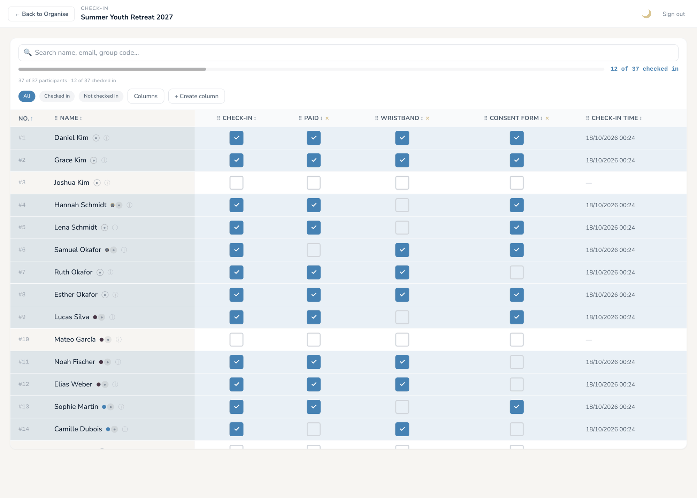

🌐 [English](07-check-in.md) · **Deutsch** · [한국어](07-check-in.ko.md) · [Español](07-check-in.es.md) · [Português (Brasil)](07-check-in.pt-BR.md) · [Français](07-check-in.fr.md)

# 07 – Check-in

Mit dem Check-in-Bildschirm markiert das Team am Tag des Events, wer angekommen ist. Es ist eine einfache Liste mit großen Ankreuzfeldern, gemacht für Tablet oder Handy am Empfang.

  
   
  <em>Check-in-Modus</em>

---

## So kommst du zum Check-in

Was du siehst, hängt davon ab, wer du bist.

**Admins** (Super-Admin oder Event-Admin) klicken auf der Hauptseite des Events auf **Check-in-Modus starten →**. Der Button erscheint in der Eventphase, solange das Event **Vor dem Start** oder **Live** ist (nicht mehr, wenn es **Abgeschlossen** ist). Er öffnet eine Vollbildansicht ohne Seitenleiste, die nur den Eventnamen, einen Theme-Schalter und **Abmelden** zeigt. **← Zurück zur Einteilung** bringt dich zur normalen Admin-Ansicht zurück. Wenn alle Gruppentypen bestätigt sind, bietet die Einteilungsansicht außerdem die Abkürzung **Check-in ist bereit →** an.

**Mitarbeiter, deren einzige Berechtigung der Check-in ist**, kommen direkt in diese Vollbildansicht, wenn sie das Event in der Eventphase öffnen. Einen Ausgang gibt es nicht: Das ist ihr Bildschirm für die Schicht.

**Mitarbeiter mit Check-in und weiteren Berechtigungen** (zum Beispiel Check-in und Teilnehmer) sehen **Check-in** in der Seitenleiste. Darüber öffnen sie dieselbe Check-in-Liste innerhalb der normalen Admin-Oberfläche und können so zwischen ihren Aufgaben wechseln.

Mitarbeiter mit **Zugang vor Beginn des Events** können den Check-in auch schon in der Anmeldephase öffnen (siehe [Kapitel 11](11-staff-permissions.de.md)).

Egal, auf welchem Weg du dorthin kommst, die Daten sind dieselben: Ein Haken auf einem Gerät erscheint innerhalb von ein, zwei Sekunden auf allen anderen Bildschirmen.

---

## Die Check-in-Liste

Jede Zeile ist eine teilnehmende Person. Alle Angemeldeten erscheinen, bestätigt oder noch ausstehend; stornierte Anmeldungen nicht.

Oben findest du:

- Ein **Suchfeld** (*„Name, E-Mail oder Gruppencode suchen...“*). Es findet auch Teilnehmernummern und Namen von Markierungen und ignoriert Akzente, Bindestriche und Schreibvarianten wie Müller / Mueller.
- Einen Fortschrittsbalken mit *„28 von 34 eingecheckt“*.
- Die Filter **Alle**, **Eingecheckt**, **Nicht eingecheckt**.
- **Spalten**, um auszuwählen, welche Spalten angezeigt werden.
- **+ Spalte erstellen** (Admins und Mitarbeiter mit **Zugang vor Beginn des Events**).

Standardmäßig werden diese Spalten angezeigt:

- **Nr.**: die Nummer der Person in diesem Event.
- **Name**, mit den Markierungspunkten der Person (klick darauf, um zu sehen, was die Markierungen bedeuten, oder um Markierungen zuzuweisen, wenn du darfst).
- **Check-in**: das Haupt-Ankreuzfeld für „ist angekommen“.
- **Check-in-Zeit**: wann die Person abgehakt wurde.

Klick auf **Spalten**, um weitere ein- oder auszublenden. Die Liste ist gegliedert in **Check-in-Tracking** (deine eigenen Abhak-Spalten), **Anmeldefelder** (**Gruppencode**, **Geschlecht**, **Telefon**, **Gemeinde / Organisation**, **Land**, **Adresse**, **Geburtsdatum**, **Nachricht**, **Registriert am** und **Check-in-Zeit**), **Benutzerdefinierte Felder** aus deinem Anmeldeformular und **Sonstiges** (**Notizen**, was einen Button zum Lesen und Schreiben von Notizen zu dieser Person hinzufügt). Zieh eine Spaltenüberschrift seitwärts, um umzusortieren, und klick auf eine Überschrift, um danach zu sortieren. Deine Spaltenauswahl wird auf diesem Gerät gemerkt.

Auf dem Handy ist jede Person eine Karte mit Namen und Ankreuzfeldern; tipp auf **N Details**, um die übrigen Spalten zu sehen.

---

## Eigene Check-in-Spalten

Neben dem Haupt-Haken **Check-in** kannst du Abhak-Spalten für alles hinzufügen, was du an der Tür festhalten willst: Bezahlung erhalten, T-Shirt ausgegeben, Namensschild ausgehändigt, Einverständniserklärung unterschrieben und so weiter.

Um eine hinzuzufügen, klick auf **+ Spalte erstellen**, gib einen Namen wie „Bezahlung“ oder „T-Shirt“ ein und klick auf **Hinzufügen**. Die neue Spalte erscheint mit einem leeren Ankreuzfeld für jede Person.

Um eine eigene Spalte zu löschen, klick auf das kleine ✕ neben ihrem Namen in der Spaltenüberschrift (Admins und Mitarbeiter mit **Zugang vor Beginn des Events**). Eine Rückfrage (**Spalte löschen**) warnt dich, dass die Spalte und alle ihre Haken für alle entfernt werden. Das lässt sich nicht rückgängig machen.

Gut zu wissen:

- **Mehrere Mitarbeiter können gleichzeitig an derselben Person arbeiten**, zum Beispiel hakt eine „Bezahlung“ ab, während ein anderer „T-Shirt“ abhakt.
- **Nur der Haupt-Haken „Check-in“ zählt als angekommen.** Eigene Spalten werden getrennt erfasst und ändern die „eingecheckt“-Zahlen nicht.

---

## Was ein Haken bewirkt

Haken werden sofort gespeichert; es gibt keinen Speichern-Button. Wenn du das Haupt-Feld **Check-in** ankreuzt, wird auch die Uhrzeit festgehalten und in der Spalte **Check-in-Zeit** angezeigt. Klick noch einmal auf den Haken, um ihn zurückzunehmen; die Uhrzeit wird dann ebenfalls gelöscht.

---

## Abgleich in Echtzeit

Jeder Check-in-Bildschirm bleibt mit dem Server verbunden. Sobald jemand ein Feld ankreuzt (Haupt- oder eigene Spalte, auf irgendeinem Gerät), aktualisiert sich jeder andere offene Bildschirm innerhalb von ein, zwei Sekunden. Es gibt keinen Aktualisieren-Button.

In der Praxis: Eine Teilnehmerin kommt an, Mitarbeiterin A hakt sie auf ihrem Handy ab, und Mitarbeiter B am anderen Ende des Tisches sieht sofort, wie sich die Zeile ändert. Haken zwei Personen gleichzeitig dieselbe Person ab, ist das kein Problem; das Ergebnis ist einfach „abgehakt“.

Die Verbindung läuft automatisch. Fällt das WLAN kurz aus, verbindet sich der Bildschirm von selbst wieder, sobald es zurück ist.

---

## Teilnehmerprofil

Klick auf das **ⓘ** neben einem Namen (**Profil öffnen**), um das **Teilnehmerprofil** zu öffnen: Kontaktdaten, Anmeldedaten, in welchen Gruppen die Person in jedem Gruppentyp ist (praktisch für „In welchem Zimmer bin ich?“), ihre Gruppenwünsche, benutzerdefinierte Felder und Notizen. Es ist dasselbe Fenster wie in der Einteilung. Um eine Notiz hinzuzufügen oder Markierungen zu ändern, nutze die Spalte **Notizen** und die Markierungspunkte in der Zeile.

---

## Typische Abläufe

### „Sie ist da, aber ich finde sie nicht.“

Such nach einem Teil ihres Namens, ihrer E-Mail-Adresse oder ihrem Gruppencode. Findest du sie, hak sie ab. Steht sie gar nicht in der Liste, wurde ihre Anmeldung vielleicht storniert, oder sie hat sich nie angemeldet. Bitte einen Admin, auf der Seite **Teilnehmer** nachzusehen: Eine stornierte Anmeldung lässt sich wieder auf bestätigt setzen, und dann erscheint sie sofort im Check-in.

### „Ich muss einen Haken zurücknehmen.“

Klick noch einmal auf den Haken. Er wird entfernt, und die Check-in-Zeit wird gelöscht.

### „Wir sind zu zweit am selben Tisch. Kommen wir uns nicht in die Quere?“

Nein. Jede von euch kann auf dem eigenen Gerät suchen und abhaken, und beide Bildschirme bleiben synchron.

### „Wir nutzen unser eigenes System für Bezahlung oder Einverständniserklärungen. Können wir nur die Ankünfte erfassen?“

Ja. Leg einfach keine eigenen Spalten an; der Haupt-Haken **Check-in** funktioniert auch allein.

### „Wie bekomme ich eine Liste, wer angekommen ist?“

Zwei Möglichkeiten:

- Klick unter **Teilnehmer** auf **↓ Exportieren ▾ ▸ Vollständige Teilnehmerliste**. Die CSV hat für alle eine Spalte **Checked In** (Yes / No).
- Unter **Berichte** zeigt die Kachel **Check-in** in der Eventphase den aktuellen Stand. Als Papier-Backup an der Tür druckst du die Liste **Check-in** aus (siehe [Kapitel 08](08-reports-and-pdf-exports.de.md)).

---

## Wie es weitergeht

[Kapitel 08 – Berichte und PDF-Exporte](08-reports-and-pdf-exports.de.md) erklärt die Seite „Berichte“, druckbare Listen als PDF in verschiedenen Formaten und Sprachen und was die Listen über deine Zuweisung zeigen.
