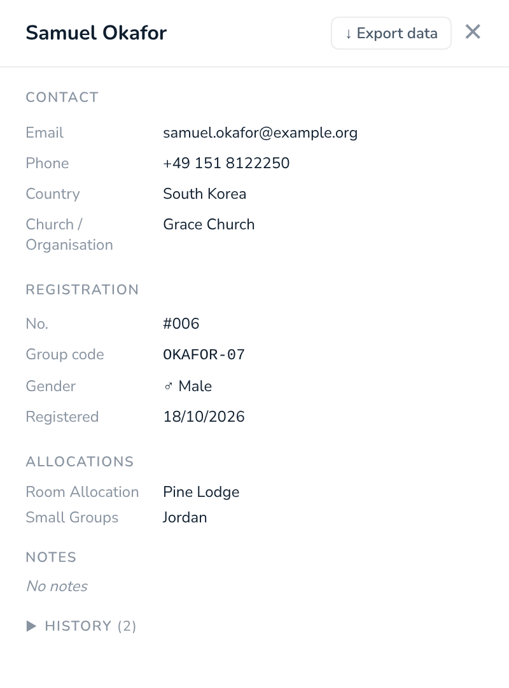

# 09 — Data export & GDPR

Moimio is built so that an organiser running an event can fulfil their GDPR obligations as a data controller without leaving the app. The relevant pieces are: per-participant data export (Article 15 / Article 20), in-place editing (Article 16), removal (Article 17), event-level backup, and clear handling of cancelled participants.

This section is operational — what to do when. For the architectural and legal posture, see [GDPR compliance](../gdpr-compliance.md).

  
   
  <em>The profile panel, with the Export data button at the top</em>

---

## Per-participant export — when a participant asks for their data

Article 15 (right of access) and Article 20 (data portability) both come up: a participant emails you saying "send me everything you have on me."

### How to do it

Personal data exports are for **Event Admins** of that event and **Super Admins**. There are two places to start:

- **From the People table.** Find their row and click **↓ Export data** in the Actions column. (Recommended for routine requests — fastest path.)
- **From the profile panel.** On the allocation board or in Check-in, click the small **ⓘ** icon (**View profile**) next to the participant's name, then click **↓ Export data** at the top of the panel. Same file, same content. Handy when you're already looking at the person and a request comes in.

Either way:

1. Your browser downloads a single file: `participant-export-{participant number}-{date}.json`.
2. Send the file to the participant via whatever channel they used to ask for it.

Cancelled participants can be exported the same way — they stay in the People table, greyed out.

### What's in the file

A single JSON document (a standard, machine-readable format) with these sections:

- **`export_metadata`** — format version, when the file was made, and a short note about what's left out.
- **`event`** — the event they registered for: name, description, location, time zone and dates. Nothing about other participants or the rest of your setup.
- **`participant`** — their registration record: name, email, gender, date of birth, phone, address, country, church/organisation, message, group code, status, consent, check-in state, language, and when the record was created, changed or removed.
- **`custom_fields`** — every answer to your custom questions, with the question's label.
- **`marks`** — every mark they carry, with its name, colour and when it was given.
- **`preference_requests`** — "I want to be grouped with…" requests they made, and requests other people made naming them.
- **`allocations`** — which group they're in, in every group type.
- **`exclusions`** — any group type you've kept them out of.
- **`allocation_history`** — the history of moves into, between and out of groups.
- **`notes`** — only published notes written about this participant.
- **`checkin_values`** — every tick in your check-in columns.

### What's excluded — and why

- **Unpublished (draft) notes.** Drafts are a team member's working notes, not published correspondence.
- **Who on your team moved them.** The history says what happened and when, not which team member did it.
- **Other participants' data**, even people in the same group code or the same room. Each person gets only their own data.

Every export is also recorded in the server log (`data_export_generated`), with the event, the participant and who downloaded it.

---

## Article 16 — rectification (the participant says "fix this")

If the participant tells you a value is wrong, open **People** and click the value to edit it in place. Name, email, gender, date of birth, phone, address, country, church/organisation, group code, status and custom-field answers can all be edited this way — see [§03](03-people.md). The participant's own message to you is read-only, so it's never overwritten by mistake.

---

## Article 17 — erasure ("right to be forgotten")

Two operations, two different intents:

### Remove (the everyday case)

In the People table, click **Remove** in the participant's Actions column, then **Remove Participant** to confirm. Only Event Admins and Super Admins see this button.

The participant disappears from everyday use — People, the allocation board, Check-in, reports, exports and the allocation. They're also left out of any backup made afterwards. The record itself is kept in the database for record-keeping. There's no button to bring someone back; whoever runs your server can restore them in the database if needed.

This is the right path for *"I changed my mind, I'm not coming"* or *"please take me off your lists."*

### Permanent erasure (the rare case)

There's no button that permanently wipes a single person in this version — an irreversible "delete forever" is too easy to click by accident. Your options:

- **Delete the whole event** (Super Admin: **Danger zone ▸ Delete event**, on the Setup hub or the Event details page) once it's over and you no longer need it. That permanently erases everyone registered for it. Download a backup first if you might need the records.
- **For one person**, ask whoever runs your Moimio server to remove the record from the database. See [GDPR compliance](../gdpr-compliance.md) for the background.

---

## Privacy notice link on the registration form

If your organisation has its own privacy notice, put its web address in **Workspace ▸ Privacy notice ▸ Privacy notice URL** (Super Admin) and click **Save**. The public registration form then shows a **Privacy notice** link right after the consent sentence. Leave it empty and no link is shown.

---

## Backups

Beyond per-participant exports, Moimio can back up whole events.

### Where to find it

Sidebar ▸ **Backup** (under **Manage**, Super Admin only). The page is headed **Export**.

### Making a backup

1. Tick one or more events under **Download event backups** (or **Select all**).
2. Under **Backup contents**, choose:
   - **Full backup** — every part of the event: participants, their answers, groups and allocations, exclusions, marks, preferences, notes, check-in columns and ticks, history, your settings and rules, and the original dates. Use this as a safety copy, before a big change, or to move an event to another Moimio.
   - **Structure only (GDPR-safe)** — the event's shape without any personal data: registration form, custom questions, group types and their groups, marks, check-in columns and settings. No participants, no notes, and not your email sender details. Safe to share with another organisation as a template.
3. Click **Download {n} backup(s)**. Each event downloads as its own `.zip` file (structure-only files have `-structure` in the name).

A few things worth knowing:

- **Notes:** a full backup holds every published note, plus *your own* draft notes. Other team members' drafts are never in it.
- **Removed participants** are not in backups.
- **Team members and their roles are never part of a backup.** Invite your team again after restoring.

### Restoring

On the Backup page, click **↑ Restore from backup** (the **↑ From backup** button on the events list takes you to the same place). Upload the `.zip`; Moimio shows a preview — event name, when it was exported, how many participants and allocations — then click **Restore event**.

- A **new** event is created, named `{original name} (Restored)` and placed back in the Setup phase. The original isn't touched.
- It keeps its original dates, so it sits in the events list where the original did. Click **Open the restored event** to go straight to it.
- If part of the file is damaged, Moimio leaves out only the lines it can't read and carries on. The result tells you how many lines were left out, how many entries had to be shortened, and how many values fell back to the standard setting.
- Older backup files still restore.

Restoring is Super Admin only.

### Moving a whole workspace

The Backup page handles one event at a time. To move every event at once, to a Moimio you run yourself, there is a whole-workspace export and a single command that restores it (with a trial run that changes nothing). See [Moving a workspace to your own Moimio](../moving-a-workspace.md).

---

## Cancelled participants

Cancellation isn't deletion — it's a status change. Cancelled participants stay in the People table, greyed out, so you keep a clear record. Their data is still there and the per-participant export still works for them. To take them off your lists, use **Remove** (above).

For Article 18 (restriction of processing), the cancelled status acts as a soft restriction: cancelled participants are left out of the allocation, Check-in, rosters and most reports. Their data isn't being used for the event; it's just kept.

---

## What's next

[Section 10 — Multi-event & archive](10-multi-event-and-archive.md) covers running multiple events from the same Moimio instance, archiving past events without deleting them, what changes when an event is archived, and reusing a past event's setup.
